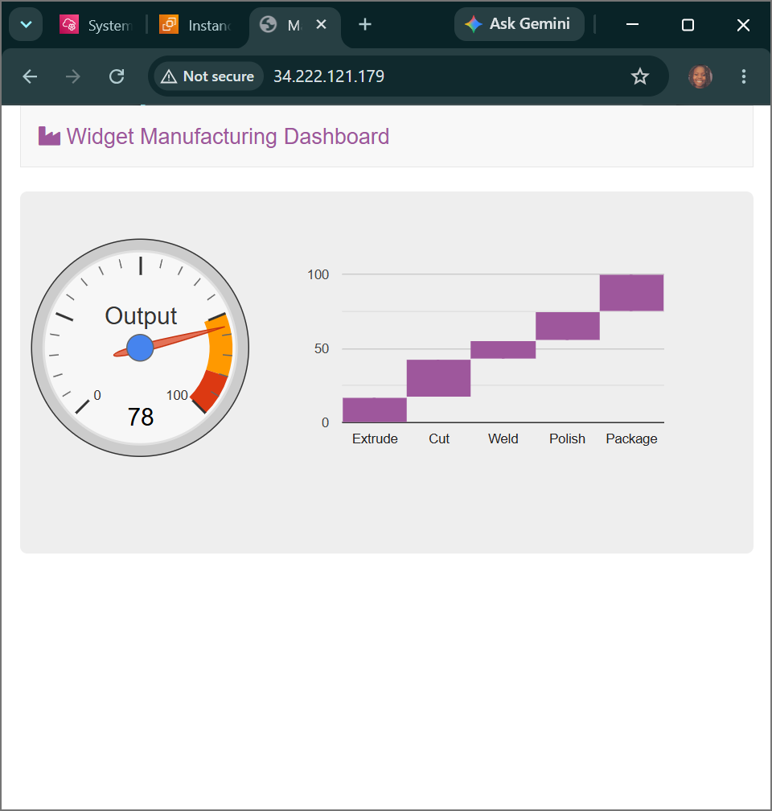
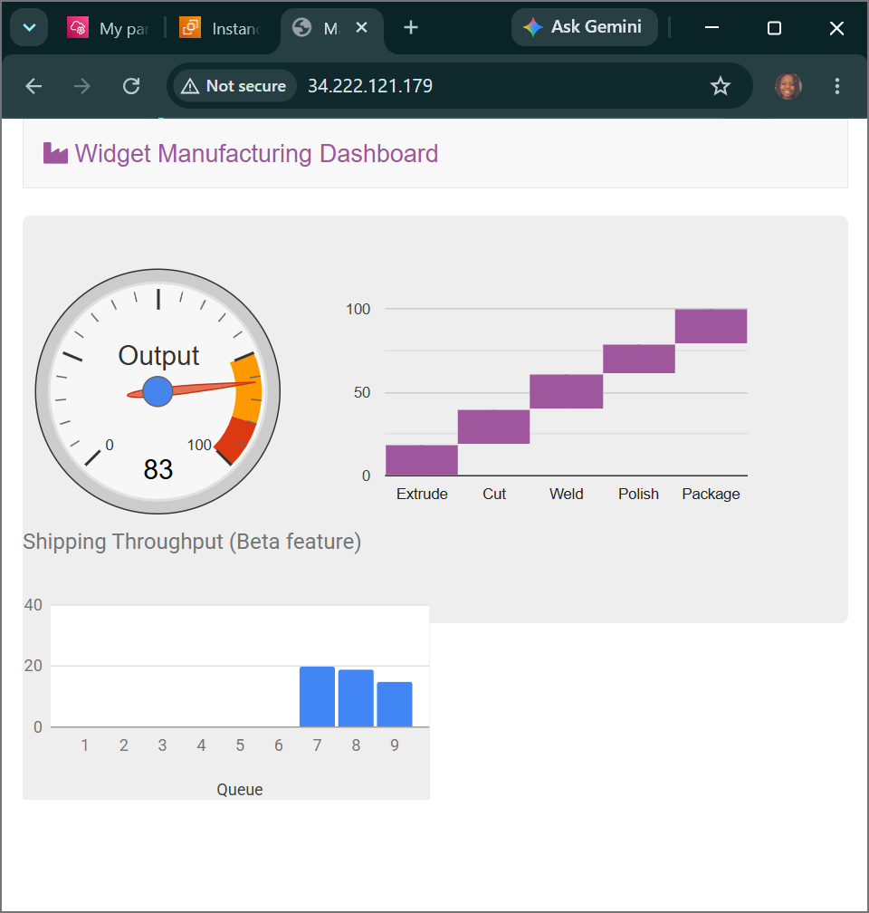
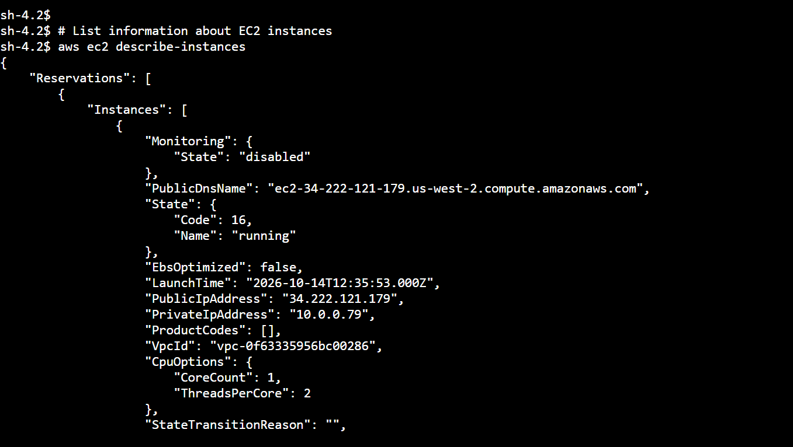

# AWS Cloud Automation: AWS Systems Manager - Fleet Inventory Aggregation, Automated Run Commands, Parameter Decoupling & Browser-Native Shell Sessions

## 📌 Section Overview
This module documents the practical implementation, node management capabilities, and security auditing frameworks that define **AWS Systems Manager (SSM)** within enterprise cloud automation workflows [2.12]. To eliminate the overhead of manual system tracking and legacy SSH perimeter exposures, we configured automated metadata inventory association loops, deployed a custom target application package remotely via asynchronous Run Commands, managed application runtime feature flips utilizing the centralized Parameter Store vault, and established an encrypted interactive management shell session completely via the web client layer [2.12].

---

## 🚀 The Systems Manager Core Automation Suite

AWS Systems Manager functions as the primary hub to unify operational insights and automate administrative infrastructure actions across hybrid compute nodes:
- **Fleet Manager & Inventory Tracking:** Aggregates granular server metadata (such as installed application arrays, network configurations, OS patch versions, and system settings) automatically into a structured inventory matrix without consuming processing cycles on the local machine.
- **Run Command (Asynchronous Execution):** Allows administrators to safely run pre-configured scripts or configuration blocks globally across a target fleet of thousands of instances concurrently without logging into them line-by-line. This completely neutralizes the need for open administrative backdoors.
- **Parameter Store (Decoupled State Vault):** A secure, centralized configuration management store that holds configuration parameters, application flags, and secure credential strings. By pointing applications to parameter keys instead of hardcoding values inside code modules, engineers can flip runtime application states (such as unlocking beta features) on the fly with near-zero friction.
- **Session Manager (Secure Interactive Shells):** Provides robust, end-to-end encrypted terminal shell access directly inside a secure browser tab [2.12]. Session Manager eliminates the severe security liabilities of legacy SSH (port 22) connections by channeling traffic securely over standard outbound HTTPS (port 443), mapping all access rights strictly to granular IAM policy permissions while logging 100% of user keystroke commands inside AWS CloudTrail for strict auditing [2.12].

---

## 🛠️ Step-by-Step Automation Lifecycle

### 1. Ingestion of Fleet Analytics
- Initialized a custom inventory association structure (`Inventory-Association`) inside the Fleet Manager console, targeting the `Managed Instance` node manually.
- Triggered automated system audits, enabling the SSM agent to cleanly catalog the machine’s baseline software assets and system profiles.

### 2. Remote Package Installation via Run Command
- Executed an asynchronous Run Command targeting the SSM document owned by the account.
- Selected the `Managed Instance` host target, disabled external storage bucket outputs, and fired the execution loop. The SSM agent securely parsed the document instructions internally and compiled the **Widget Manufacturing Dashboard** application stack smoothly over a private communication channel.

### 3. Application State Modification via Parameter Store
- Provisioned a new parameter string inside the Parameter Store database vault mapped exactly to the key path: `/dashboard/show-beta-features`.
- Set the parameter value to `True`. Upon refreshing the application page front-end, the code successfully fetched the newly updated key string state from the AWS backend API, dynamically rendering the experimental beta interface features block on screen.

### 4. Bypassing SSH via Session Manager Shell Tunnels
- Triggered an encrypted browser-native command session (`Start session`) targeting the server.
- Navigated the system directories using the web console pane to audit the local web root (`ls /var/www/html`).
- Extracted localized cluster instance data by curling IMDSv2 metadata links and executing advanced programmatic queries across the private API plane [2.12]:
  ```bash
  aws ec2 describe-instances
  ```
- **Result Output:** The system processed the command line block and returned a structured JSON metadata document describing the compute environment parameters without needing an open port 22 firewall rule.

---

## 📸 Technical Verification Proofs

### Automated Application Deployment: Successful Ingest Execution via the SSM Run Command Engine


### Centralized Parameter Inversion: Real-Time Decoupled Feature Activation Tracking


### Encrypted Session Management: Interactive Terminal Shell Querying over HTTPS Web Tunnels

