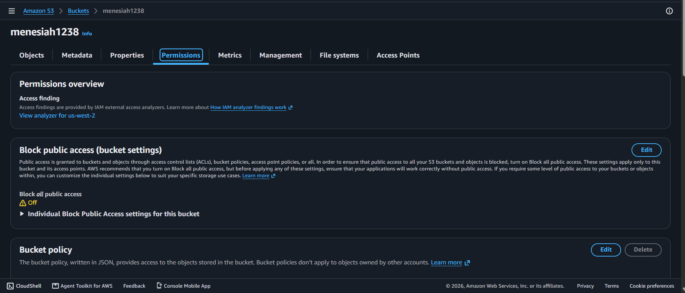
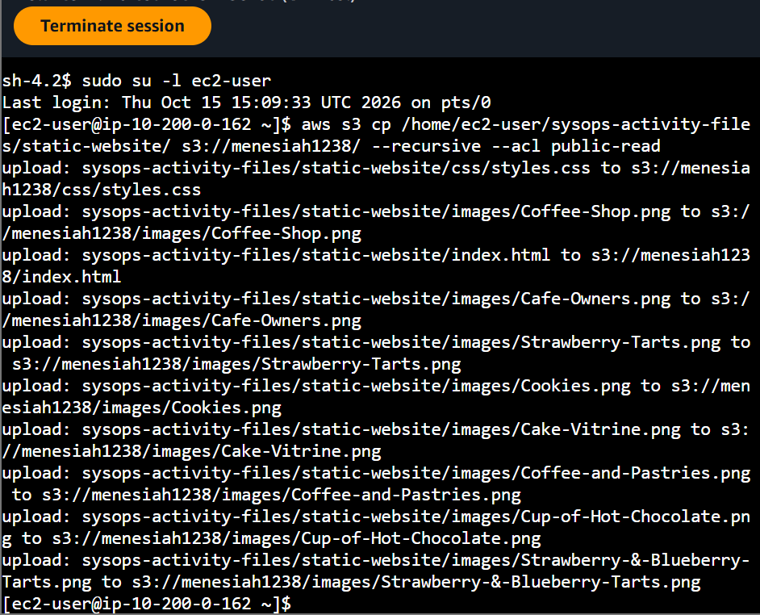
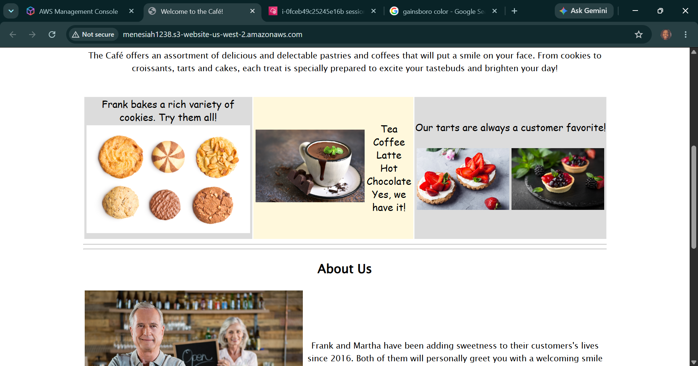

# AWS Cloud Systems Operations: Serverless Asset Deployment - Programmatic S3 Website Hosting, Custom IAM Policy Delegation & Delta Synchronization Pipelines

## 📌 Section Overview
This module documents the practical infrastructure execution of **Serverless Data Hosting, Programmatic User Delegation, Access Control List (ACL) Manipulation, and Delta Ingestion Scripting** within a live systems operations pipeline. To analyze how to automate web-tier content delivery efficiently, we initialized a secure storage bucket via the AWS CLI, provisioned a sandboxed IAM identity (`awsS3user`) mapped to full storage managed policies, deactivated standard bucket privacy locks, and engineered an automated shell script wrapper (`.sh`) using the efficient `aws s3 sync` command to deploy real-time front-end application adjustments cleanly.

---

## 🚀 Programmatic Data Pipelines & Infrastructure Security

### 1. Granular Privilege Delegation via AWS CLI
Managing modern cloud environments requires isolating administrative access domains. Instead of deploying workloads under root accounts or heavy master parameters, engineers use the CLI tool to provision single-responsibility identities (`aws iam create-user`). By running specific JMESPath string queries (`--query`), engineers parse global policy directories to extract targeted permission definitions—such as locating **`AmazonS3FullAccess`**. Attaching this customer-managed policy ARN ensures that the decoupled app user profile holds the explicit data manipulation permissions necessary to manage files, without gaining unsafe control over other cloud resources.

### 2. Overriding the S3 Security Perimeter (Public Ingestion Blocks)
By default, Amazon S3 locks down object storage nodes by enforcing an implicit *Block Public Access* baseline barrier. To transition an unmanaged storage vault into an accessible web cluster, the security configuration must be explicitly adjusted:
- **Public Access Disengagement:** The outer boundary settings must be modified to allow anonymous reads.
- **Access Control List (ACL) Enablement:** Object Ownership parameters must be edited to enable ACL write access. This ensures that when uploading code files from a local source directory, an explicit **`--acl public-read`** parameter string flag can be attached to the data packet, granting public access to view individual files over standard web connections.

### 3. Engineering Delta Optimization: `aws s3 cp` vs. `aws s3 sync`
When managing production deployment pipelines, minimizing processing cycles and network bandwidth is a key cost-control standard:
- **`aws s3 cp --recursive`:** A heavy copy command that forces the terminal to upload *every single file* present inside the local source directory onto the target S3 bucket, regardless of whether the file was changed. This creates network latency loops for large media assets.
- **`aws s3 sync` (The Delta Engine):** A highly optimized synchronization utility that performs a differential comparison check between the local directory and the remote S3 storage layer before execution. It computes timestamps and file sizes, and **uploads only the specific files carrying structural text modifications (deltas)**. This makes the deployment loop fast, lean, and highly efficient.

---

## 🛠️ Step-by-Step Systems Engineering Lifecycle

### 1. Ingestion Partition Initialization
- Authenticated your Git Bash terminal panel session to connect securely to your lab cloud environment.
- Created a unique Amazon S3 bucket partition inside the `us-west-2` regional cluster canvas:
  ```bash
  aws s3api create-bucket --bucket twhitlock256 --region us-west-2 --create-bucket-configuration LocationConstraint=us-west-2
  ```

### 2. Programmatic User Creation & Security Mapping
- Provisioned a decoupled IAM user account profile named `awsS3user` and assigned a strong console password string.
- Queried the global AWS policy records using JMESPath criteria filters to pinpoint the Amazon S3 managed full-access ARN string:
  ```bash
  aws iam list-policies --query "Policies[?contains(PolicyName,'S3')]"
  ```
- Attached the policy ARN to your new user node, establishing a secure data manipulation pipeline.

### 3. Permissions Tuning and Initial Application Upload
- Navigated to the Amazon S3 Management Console, deactivated the parent bucket's global *Block Public Access* setting, and enabled object ACL writes.
- Unpacked the pre-compiled frontend website archive compression files (`static-website-v2.tar.gz`) into your local server user directory.
- Executed an automated CLI command to turn on static web hosting, setting `index.html` as your default index entry point document. Recursive-copied the application stack directory directly into your remote storage pool:
  ```bash
  aws s3 cp ~/sysops-activity-files/static-website/ s3://twhitlock256/ --recursive --acl public-read
  ```

### 4. Designing the Repeatable Synchronization Script (Optional Challenge Resolution)
- Formulated an executable bash shell document (`update-website.sh`), assigning file system execution execution parameters using the `chmod +x` tool check.
- Opened the local source files inside the `vi` terminal editor tool to adjust background layout colors to `gainsboro` and `cornsilk` strings.
- **Challenge Execution Analysis:** Replaced the legacy `cp --recursive` statement block with the optimized **`aws s3 sync`** operator. Upon executing `./update-website.sh`, the terminal telemetry logs confirmed that the engine evaluated the entire tree, bypassed copying unmodified image folders, and **uploaded strictly the single modified `index.html` file asset**, maximizing pipeline deployment speed.

---

## 📸 Technical Verification Proofs

### Permissions Override: Deactivating Global Block Filters and Enabling Object Ownership ACLs


### Automated Directory Ingestion: Batch Uploading Code Files carrying Public-Read ACL Marks


### Delta Pipeline Revision: Scripted Incremental Website Updates and Refresh Validations

