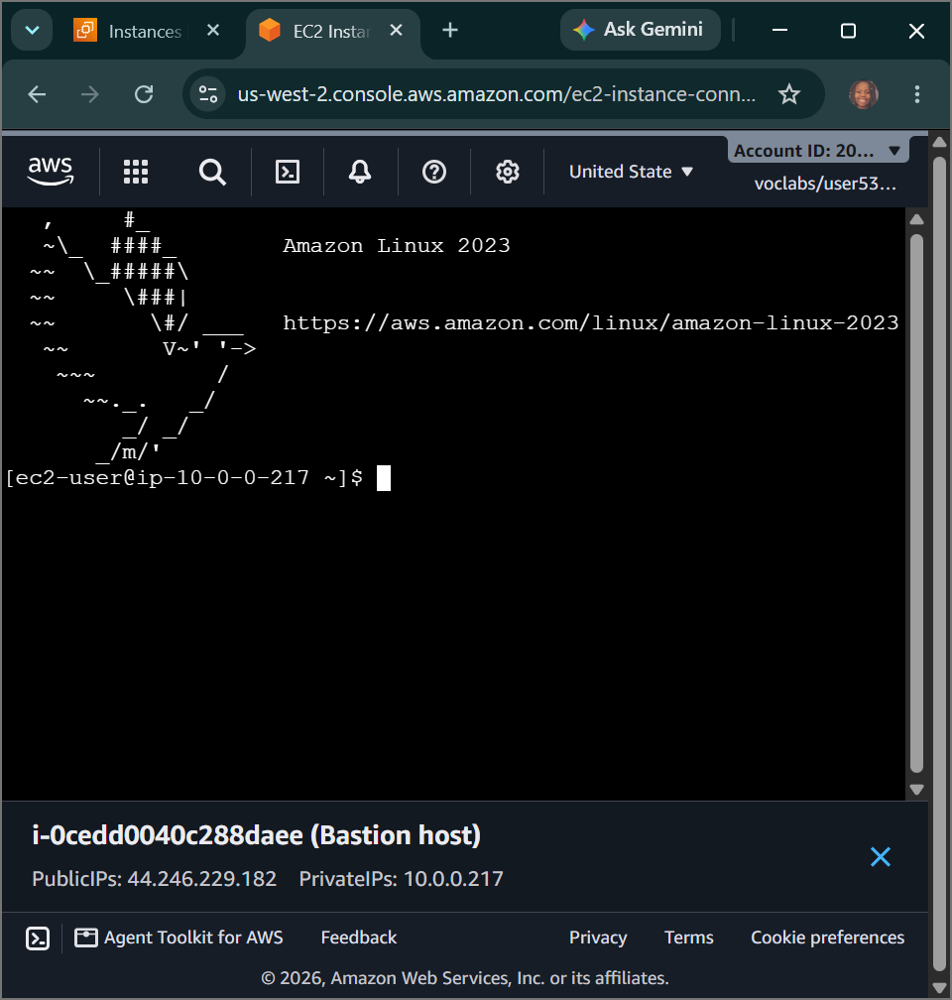
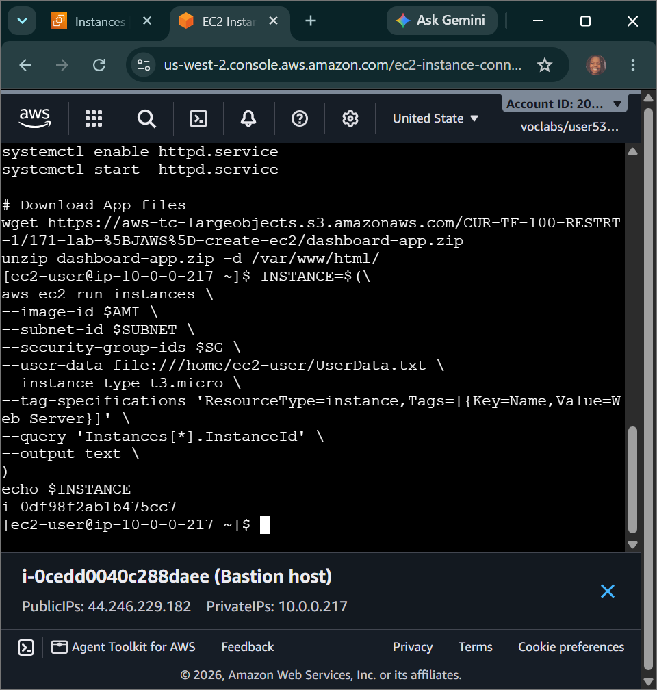
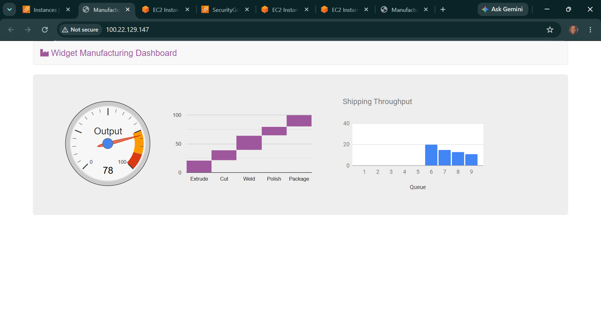

# AWS Cloud Systems Operations: Managing AWS EC2 Instances - Bastion Perimeter Configurations, Automated Ingestion Scripts & Forensic Infrastructure Triage

## 📌 Section Overview
This module documents the practical implementation, instance state transitions, and environmental triage methodologies required to manage **Amazon Elastic Compute Cloud (EC2) Fleets** at an enterprise scale. To analyze how configuration changes affect runtime environments, we provisioned an isolated perimeter access node (**Bastion Host**) via the management console, utilized an active SSH session to launch a secondary web tier node programmatically via the AWS CLI, and executed deep forensic troubleshooting loops to clear security group blocks and resolve broken application system hooks.

---

## 🚀 Infrastructure Topology & Compute Lifecycles

### 1. The Anatomy of a Bastion Host Perimeter
In production cloud operations, backend database nodes and core web systems are locked inside completely private subnets to block external malicious internet scans. To manage these private resources, architects build a **Bastion Host (Jump Box)** inside a public network partition:
- **The Proxy Shield:** The Bastion acts as a single, heavily fortified gatekeeper node. It is the only machine exposed to authorized administrator connections.
- **Network Routing Flow:** Engineers connect to the Bastion via secure browser-native tools (EC2 Instance Connect) and then "jump" across internal private network lines to troubleshoot backend servers safely.

### 2. State Characteristics & Hibernation Mechanics
Compute instances transition through explicit states that impact operational billing, CPU usage, and hard drive cache persistence:
- **Stopped:** The instance shuts down its CPU processing cores entirely. Compute billing freezes instantly, but storage volumes (EBS) continue to accumulate space allocation costs.
- **Hibernated (Suspend-to-Disk):** The database processing engine takes the current active system memory state (RAM heap) and dumps it directly onto the underlying root storage volume before halting the CPU. Upon booting back up, the kernel reloads this file, restoring application sessions exactly where they left off without losing transient processing memory.

---

## 🛠️ Step-by-Step Data & Operational Architecture Lifecycle

### 1. Manual Console Provisioning (The Access Perimeter)
- Navigated the Amazon EC2 management wizard to build the **`Bastion host`** inside the `Lab VPC` network.
- Bound the resource configuration directly to a secure public subnet, attached a target IAM profile role (`Bastion-Role`) to grant secure API access, and opened the firewall layer under a custom rule: `Bastion security group`.

### 2. Programmatic Scaling via Local SSM Parameters
- Connected securely into the active Bastion shell environment over an encrypted instance connect bridge.
- Formulated custom shell scripts to query the AWS Systems Manager Parameter Store, automatically pulling down the latest validated regional image string:
  ```bash
  aws ssm get-parameters --names /aws/service/ami-amazon-linux-latest/amzn2-ami-hvm-x86_64-gp2
  ```
- Isolated the local network subnet parameters and security group strings (`WebSecurityGroup`) dynamically into shell environment variables.
- Triggered a programmatic instance run (`aws ec2 run-instances`) passing an automated bootstrapping user script file (`UserData.txt`) to compile an Apache server node named **`Web Server`** over the cloud network.

### 3. Forensic Triage & Resolution Analysis (The Challenge Deliverables)
- **Challenge 1 Remediated:** Investigated a connection block on a misconfigured node. Discovered that the security group firewall rules lacked explicit inbound permissions for SSH traffic. Modified the firewall matrix by appending an inbound rule opening TCP **Port 22** from the local subnet to restore administrative access.
- **Challenge 2 Remediated:** Investigated an application interface error where the web page failed to load. Isolated two structural errors: the network security group completely blocked inbound **Port 80 (HTTP)**, and the underlying Apache web daemon failed to start properly. Attached a public HTTP inbound firewall rule to the security group and ran system control overrides inside the operating kernel to force a clean service restart:
  ```bash
  systemctl enable httpd.service && systemctl restart httpd.service
  ```
- **Result Output:** The environment successfully stabilized, data packets traversed the firewall perimeters, and the web browser rendered the live application dashboard beautifully.

---

## 📸 Technical Verification Proofs

### Perimeter Connectivity: Successful Authorization into the Bastion Host Jump Box Environment


### Automated Cloud Scaling: Programmatic Instance Generation via the AWS CLI Engine Shell



### Forensic System Resolution: Successful Triage of Network Firewalls and Apache System Services

