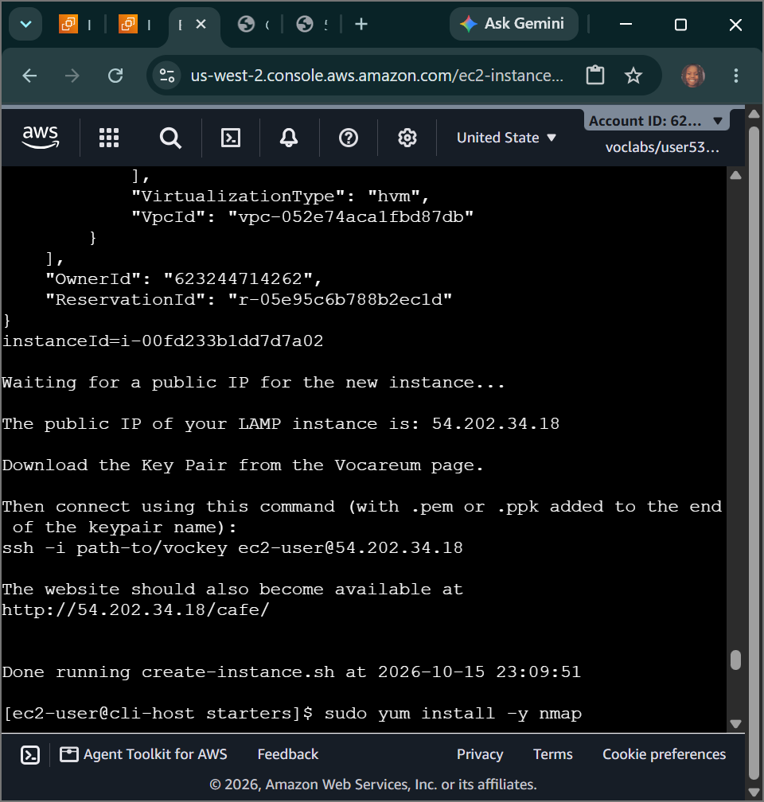
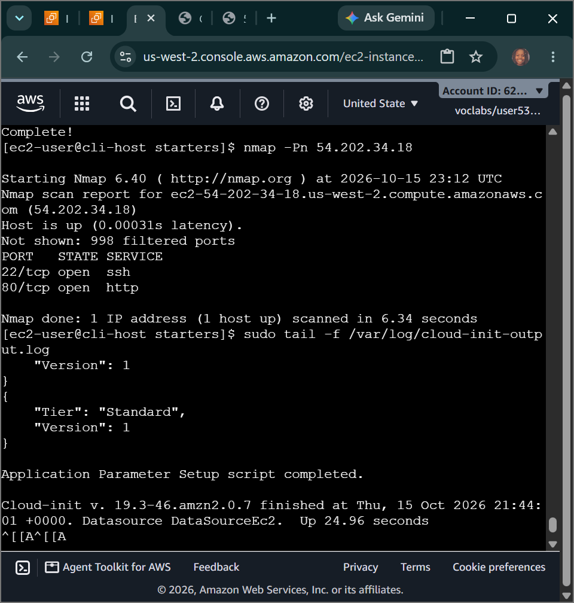
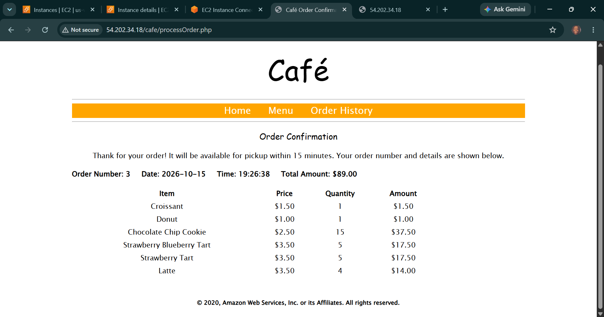

# AWS Cloud Systems Operations: AWS Elastic Beanstalk - Platform-as-Service (PaaS) Paramaneters, Scripted Fleet Deployment & Cloud-Init System Triage

## 📌 Section Overview
This module documents the architectural concepts of **AWS Elastic Beanstalk PaaS environments** alongside the forensic troubleshooting workflows required to debug automated compute deployment bash engines. To analyze how configuration anomalies break deployment pipelines, we configured an operational CLI host server, triaged regional metadata lookup errors inside an automated shell script, and audited internal system-initialization telemetry logs (`cloud-init-output.log`) to resolve a broken LAMP web tier application stack.

---

## 🚀 The Elastic Beanstalk Platform Paradigm

### 1. Platform-as-a-Service (PaaS) Automation
Traditional cloud engineering requires manually designing networks, selecting compute classes, establishing auto-scaling parameters, managing load balancers, and setting up system patch loops. **AWS Elastic Beanstalk** abstracts this entire infrastructure layer away:
- **Code-Centric Deployments:** Developers simply upload their raw code package files (e.g., a `.zip` or `.war` archive containing Java, Python, PHP, or Node.js logic strings).
- **Automated Provisioning Loop:** The Beanstalk engine automatically handles the heavy lifting of provisioning the underlying EC2 instances, setting up load balancers, creating auto-scaling groups, and tracking application health metrics behind the scenes.

### 2. Core Operational Benefits
- **Zero Management Overhead:** Minimizes engineering hours spent tracking server operating system upgrades or tuning network security groups.
- **Complete Architectural Control:** Unlike other rigid PaaS solutions, Elastic Beanstalk maintains absolute transparency. If an enterprise app requires unique tuning, a SysOps engineer can peel back the abstraction layer and take direct control over the underlying AWS resources natively.

---

## 🛠️ Step-by-Step Forensic Ingestion & Debugging Lifecycle

### 1. Programmatic Shell Ingestion Analysis
- Connected securely into the `CLI Host` instance terminal using AWS Session Manager web tunnels.
- Initialized local environment variables, running `aws configure` to map security access key tokens and locking the target execution region bounds to `us-west-2`.
- Created a localized workspace directory and isolated the baseline deployment automation shell code file:
  ```bash
  cd ~/sysops-activity-files/starters && cp create-lamp-instance-v2.sh create-lamp-instance.backup
  ```

### 2. Resolving the Regional Metadata Bug (Issue #1)
- Triggered the automated script (`./create-lamp-instance-v2.sh`) and intercepted an immediate validation exception error: `InvalidAMIID.NotFound`.
- **Forensic Diagnosis:** Discovered that the script's automated SSM lookup utility was fetching an AMI string native to a foreign region. Because AMIs are bounded regionally, passing a mismatched image token to the `run-instances` engine caused the deployment loop to crash.
- **Remediation:** Modified the script parameters inside the `vi` text editor, mapping the `--region` criteria flag to use the active variable context derived dynamically from the IMDSv2 local lookup handshake (`$AWS_DEFAULT_REGION`). Upon re-running, the script successfully bypassed the block, provisioned the server instance node, and assigned a public IP string.

### 3. Debugging Cloud-Init and Restoring the Application Stack (Issue #2)
- Attempted to curl the generated application endpoint URL, but the browser hit a connection timeout wall.
- **Port Scan Auditing:** Installed network diagnostics utilities (`sudo yum install nmap -y`) and targeted the public interface. Port 80 was open, indicating the firewall was clear, but the application was refusing to return packets.
- **Kernel Log Dissection:** Connected to the backend server via EC2 Instance Connect and tailed the core initialization pipeline log:
  ```bash
  sudo tail -f /var/log/cloud-init-output.log
  ```
- **Root-Cause Analysis:** Isolated that while the system successfully downloaded PHP and MariaDB layers, the Apache system process daemon (`httpd`) was stuck in an inactive state inside the system kernel.
- **Remediation:** Executed administrative service overrides to force the web server online:
  ```bash
  sudo systemctl enable httpd && sudo systemctl start httpd
  ```
- **Result Output:** The system stabilized instantly, the `cloud-init` logs completed their trace, and the browser loaded the **Café Web Application Interface** (`/cafe/menu.php`), allowing users to successfully compile, process, and track e-commerce order ledger metrics within the database natively.

---

## 📸 Technical Verification Proofs

### Automated Shell Success: Programmatic Multi-Parameter CLI Compute Generation Tracking


### Cloud-Init Stream Dissection: Auditing Core Operating System Boot Log Diagnostics


### Dynamic Interface Validation: Live End-to-End Café Application Database Order Tracking

