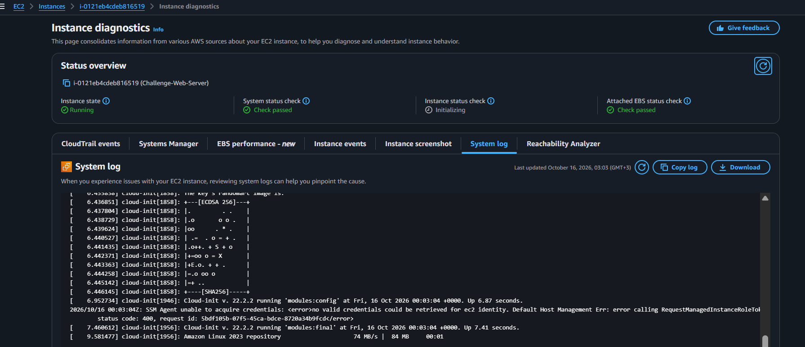

# AWS Cloud Systems Operations: Capstone Compute Challenge - Virtual Network Fabric Engineering, Automated User-Data Bootstrapping & Multi-Tier App Deployments

## 📌 Project Overview
This capstone module documents the final operational engineering implementation of the **AWS re/Start Compute Foundations Challenge**. To demonstrate complete architectural fluency in virtual networking design and automated compute lifecycle management, we engineered a custom isolated network topology from scratch—manually compiling subnets, internet gateways, and public route table associations. We then deployed a burstable Amazon Linux compute instance node carrying explicit `User Data` bootstrap shell scripts, managed security group port filters, and deployed a customized front-end HTML web asset (`projects.html`) via secure EC2 Instance Connect channels.

---

## 🚀 Architectural Network Fabrics & Bootstrapping Topologies

### 1. Manual Construction of the Virtual Network Backbone
Deploying compute resources securely requires building a robust, custom-tailored network topology before launching resources:
- **VPC Allocation and Gateway Anchoring:** Provisions an isolated IP network block (`10.0.0.0/16`) to decouple our environment from default system maps, attaching a custom **Internet Gateway (IGW)** to provide an outbound route to the public internet.
- **Route Table Association Maps:** Manually configuring the subnet's routing logic table to bind a default destination route rule (`0.0.0.0/0`) pointing straight to the IGW, turning a traditional isolated subnet into a fully functional public communication lane.

### 2. Core Automation: Automated User Data Scripts
Entering instance operating systems to configure packages manually introduces high deployment risks and slows down scaling efficiency. Modern systems operations leverage automated **User Data Scripts**:
- **The Execution Layer:** The AWS platform injects the plaintext script block directly into the machine's virtual configuration frame. The Linux system kernel intercepts the script during its first boot sequence, automatically executing administrative updates, downloading the Apache web server daemon (`httpd`), and activating service daemons natively.
- **Permissions Flattening:** Elevating and recursive-applying read/write folder parameters (`chmod -R 777 /var/www/html`) ensures that deployment pipelines and client users can smoothly write and publish application code files to the hard drive storage blocks without encountering access permission errors.

---

## 🛠️ Step-by-Step Systems Engineering Challenge Lifecycle

### 1. Building the Network Canvas
- Engineered the parent virtual private network canvas `Challenge-VPC` and isolated a public routing subnet block `Public-Subnet-Challenge`.
- Provisioned a custom internet gateway, bound it to the VPC fabric, and updated the active route table entries to direct all outside traffic paths securely through the gateway pipeline.

### 2. Provisioning and Automated Bootstrapping
- Launched a General Purpose `gp2` storage instance node using a burstable `t3.micro` hardware template.
- Bound the instance interface to the custom network subnets and attached a hardened security group firewall opening **Port 22 (SSH)** and **Port 80 (HTTP)** globally.
- Injected an advanced administrative shell script block inside the advanced details pane to fully automate the web-tier stack compilation on initialization.

### 3. Application Content Deployment and Handshake Validation
- Handshaked into the machine's active operating system kernel over encrypted browser tunnels via EC2 Instance Connect.
- Created and compiled a customized HTML web presentation code asset (`projects.html`) inside the terminal text workspace.
- Transposed the written document asset straight into the web server's core document root path (`/var/www/html/`).
- **Result Output:** Navigated directly to the live server public IPv4 URL endpoint path. The system parsed the connection request across the firewall perimeters, communicated smoothly with the web service daemon, and cleanly rendered the custom branded project page on screen.

---

## 📸 Technical Verification Proofs

### System Log Diagnostics: Verifying Successful Automated Apache Web Server Installation on Boot

### Frontend Endpoint Validation: Live Branded Webpage Deployed Over Custom Public Network Fabrics

