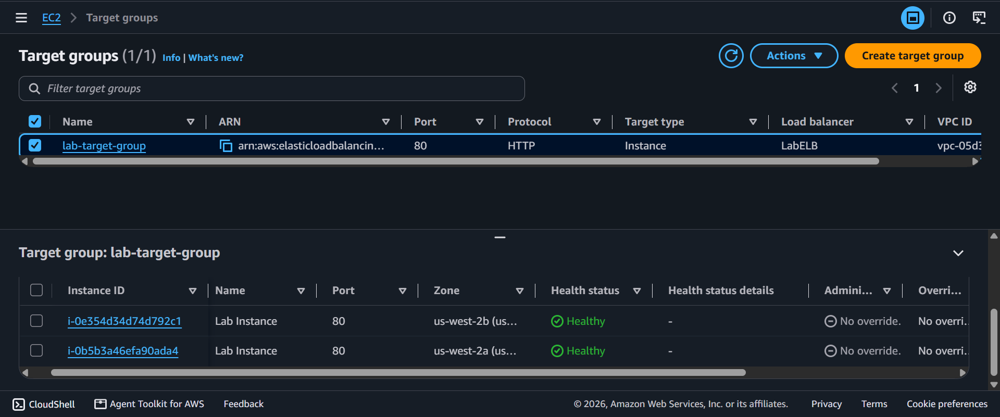
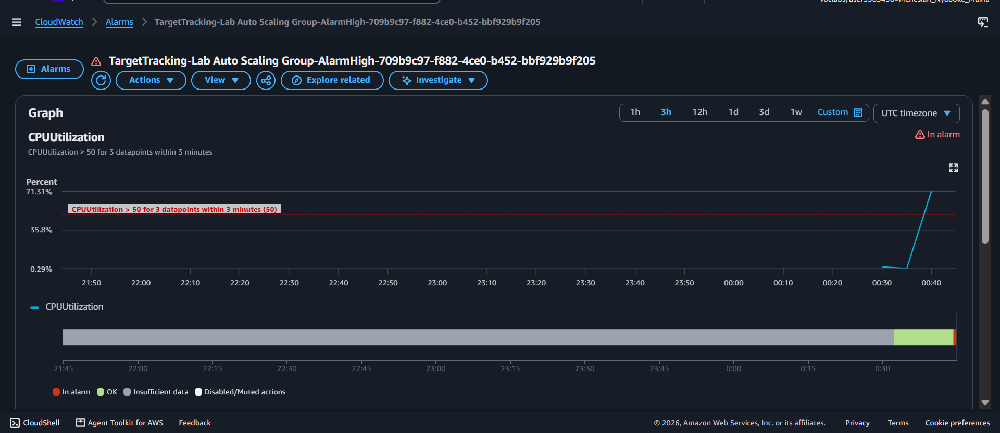
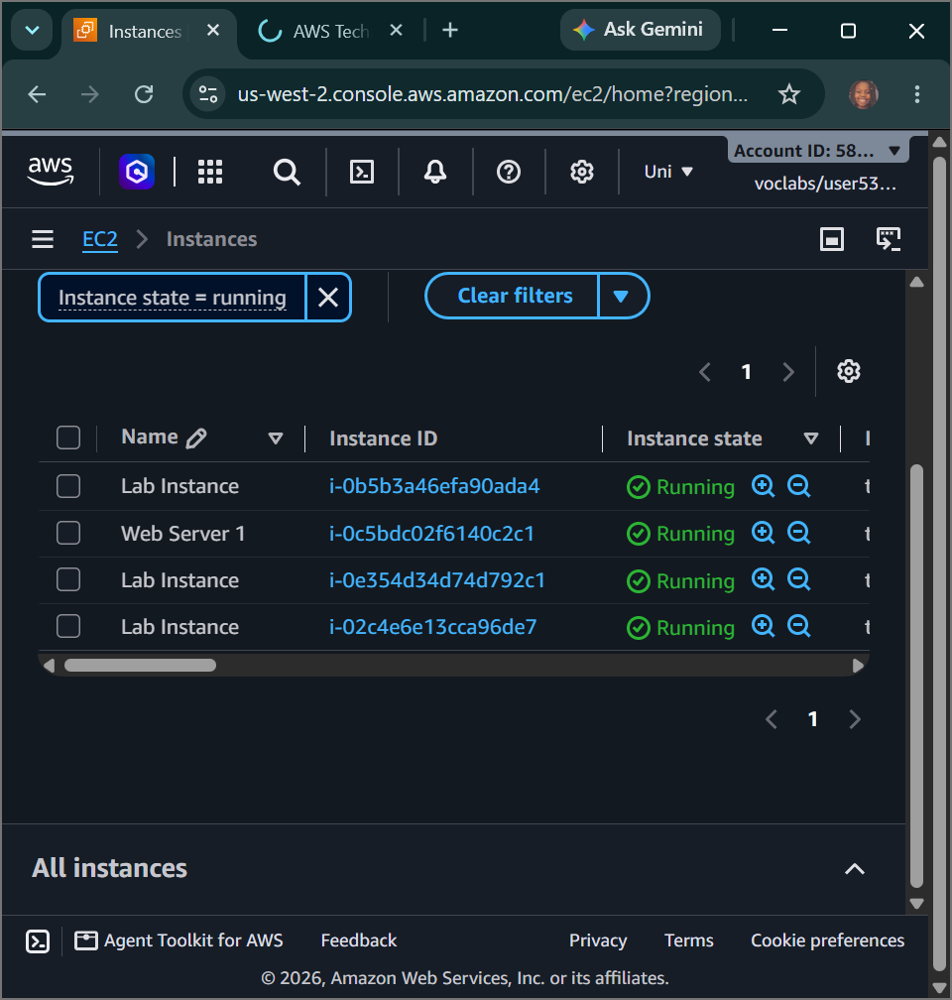

# AWS Cloud Architecture: Fleet Auto Scaling & Load Balancers - Layer 7 Application Load Balancing, Private Subnet Fleet Isolation & Metric-Driven Horizontal Scale-Out

## 📌 Section Overview
This module documents the practical engineering implementation of a highly available, fault-tolerant cloud infrastructure footprint utilizing **Layer 7 Application Load Balancers (ALB), Auto Scaling Groups (ASG), and CloudWatch Metric Alarms**. To evaluate how distributed cloud frameworks adapt to extreme user request spikes, we generated a custom Amazon Machine Image (AMI), provisioned an ALB mapping traffic routing across multiple public subnets, deployed a target tracking Auto Scaling policy with elastic limits (2 to 4 instances), isolated server nodes completely within network-secure private subnets, and executed heavy compute load-tests to trigger real-time metric-driven horizontal scale-out loops.

---

## 🚀 Elastic Infrastructure Architecture & Traffic Management

### 1. Application Load Balancer Listener & Routing Mechanics
A modern web infrastructure requires a centralized entrance channel to handle incoming user data streams:
- **Listeners:** Processes configured on the load balancer to continuously check for connection requests based on protocol and port rules (e.g., listening for HTTP on Port 80).
- **Target Groups:** Logical groupings that route traffic to specific registered backend resources (such as EC2 instances). The ALB intercepts inbound user requests and checks target health states via automated pings before routing traffic.

### 2. High-Availability Auto Scaling Group Realization
- **Launch Templates:** Immutable configuration blueprints defining *what* the scaling engine should build whenever capacity needs to expand (specifying custom AMI blueprints, security groups, instance classes, and initialization user data).
- **Subnet Isolation Boundaries:** To minimize perimeter attack fields, instances are anchored inside **Private Subnets** with zero public internet routing. The load balancer acts as a reverse proxy shield in the public subnet, taking 100% of user traffic and shifting it across internal private lines to backend instances safely.
- **Target Tracking Scaling Policies:** Enforce mathematical target ceilings across the fleet (e.g., maintaining an average CPU load of 50%). When live user activity breaches this threshold, the Auto Scaling engine communicates with the EC2 control plane to automatically spawn fresh servers.

---

## 🛠️ Step-by-Step Systems Engineering Implementation

### 1. Ingestion of the Reusable Server Snapshot
- Selected the active `Web Server 1` baseline instance node and executed an image generation command to create **`Web Server AMI`**, locking down the complete boot volume file system state into a reusable image blueprint.

### 2. Provisioning the Layer 7 Application Load Balancer
- Launched an Application Load Balancer named **`LabELB`**, mapping its network parameters to run across public routing subnet subnets in multiple Availability Zones.
- Bound the interface security rules to the `Web Security Group` to permit open web traffic, and engineered a custom target instance registration layout: **`lab-target-group`**.

### 3. Formulating Launch Templates and Scaling Boundaries
- Built an enterprise launch template labeled **`lab-app-launch-template`**, mapping the image blueprint to a burstable `t3.micro` instance class bound to the web security group.
- Spawned an Auto Scaling Group (**`Lab Auto Scaling Group`**) linked to the template, mapping the network boundaries to private subnets across multiple availability zones.
- Configured elastic capacity limits: **Desired = 2, Minimum = 2, Maximum = 4**, and attached a metric-driven **Target Tracking scaling policy** set to trigger if average CPU utilization crosses 50%.

### 4. Stress Testing & Metric-Driven Horizontal Scale-Out
- Accessed the public DNS endpoint of the Application Load Balancer via an open web browser tab, successfully hitting the web application interface.
- Triggered the application's automated **Load Test calculations engine loop**, forcing the running instances to generate heavy processing load states.
- Navigated to the **Amazon CloudWatch** console to audit alarm states. Intercepted the metric trace as the CPU load surged past 50%, forcing the `AlarmHigh` status to enter an active red **`In alarm`** alert phase.
- **Result Output:** The Auto Scaling Group successfully parsed the alarm, triggered a horizontal scale-out transaction, and automatically spun up fresh **Lab Instance** nodes in the private subnets to absorb the traffic load and protect system uptime.

---

## 📸 Technical Verification Proofs

### Target Fleet Verification: Registered Backend EC2 Compute Instances Passing Healthy System Checks

### CloudWatch Alarm Telemetry: High CPU Utilization Metric Breach Triggering an Active In-Alarm State

### Automated Fleet Scaling: Successful Horizontal Scale-Out Generating Additional Server Instances

