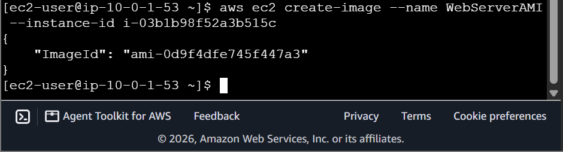
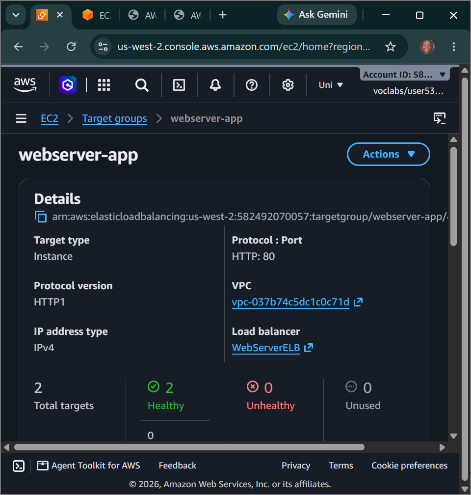
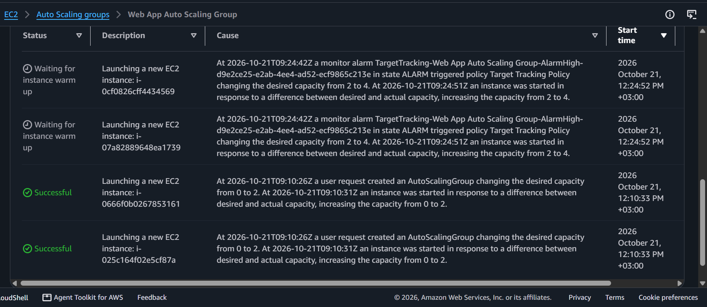

# AWS Cloud Architecture: High-Availability Automated Scaling - Programmatic AMI Baking, Private Subnet Multi-AZ Routing & Real-Time CPU Stress Scale-Out

## 📌 Section Overview
This module documents the practical implementation, automation scripts, and cluster scaling metrics that define **High-Availability System Architecture and Elastic Load Balancing (ELB)** within cloud environments. To demonstrate complete operational fluency in automated compute lifecycles, we leveraged the AWS CLI to programmatically launch a bootstrapping web server instance and bake a custom golden image (`WebServerAMI`). We then integrated this image into an enterprise launch template, provisioned a public Application Load Balancer across multiple public subnets, isolated application server instances inside network-secure private subnets, and initiated high-velocity PHP background calculations to trigger automated horizontal scale-out loops.

---

## 🚀 Architectural Foundations & High-Availability Topologies

### 1. Programmatic AMI Baking & Image Ingestion
Managing large-scale computing environments requires decoupling configuration setups from real-time instance scaling loops. Using the AWS CLI to command the cloud controller plane to snapshot a running system (`aws ec2 create-image`) captures the exact operating system state, compiled binaries, and PHP dashboard codes onto a reusable **Amazon Machine Image (AMI)**. This ensures that when an automated scaling group spawns new nodes, the instances are initialized identically in seconds with no human configuration errors.

### 2. Multi-Tier Subnet Isolation & Reverse Proxy Routing
Enterprise security compliance rules mandate isolating backend computation layers from direct public internet exposure:
- **Public Subnet Edge:** The **Application Load Balancer (ALB)** is deployed across multiple public subnets (`Public Subnet 1` and `Public Subnet 2`), exposing only its centralized public DNS address to the internet. It serves as a reverse proxy firewall boundary.
- **Private Subnet Isolation:** The **Auto Scaling Group (ASG)** is configured to launch computing server nodes strictly inside isolated private subnets across multiple Availability Zones (`Private Subnet 1` and `Private Subnet 2`). These servers hold zero public IP addresses. The ALB intercepts 100% of incoming web data packets, runs automated health-check diagnostic routes (`/index.php`), and horizontally forwards the connections to healthy private instances over internal private paths.

### 3. Metric-Driven Target Tracking Policies
To maintain continuous system availability while minimizing budget consumption, the cluster deploys an automated **Target Tracking Scaling Policy** tied directly to an active **Amazon CloudWatch** alarm matrix. The policy acts as a dynamic rule loop tracking average cluster performance (e.g., targeting a 50% CPU threshold). The moment live application load breaches this boundary line, the tracking policy instantly commands the Auto Scaling engine to expand capacity, adding fresh compute nodes to preserve system stability.

---

## 🛠️ Step-by-Step Systems Operations Ingestion Lifecycle

### 1. Programmatic Baseline Image Ingestion
- Authenticated your Git Bash terminal panel into the `Command Host` Linux EC2 instance using secure instance connect web tunnels.
- Configured local CLI environment profiles (`aws configure`) and initialized a script parameter loop to fetch system subnet markers.
- Dispatched an API request (`aws ec2 run-instances`) to spin up an initial `WebServer` host node carrying an automated user-data bootstrap text script.
- Captured the server state, executing an immediate image compile script to save the underlying file system into a permanent blueprint repository:
  ```bash
  aws ec2 create-image --name WebServerAMI --instance-id i-0abcdef1234567890
  ```

### 2. Provisioning the Layer 7 Application Load Balancer
- Switched to the graphical web console to deploy an Application Load Balancer named **`WebServerELB`** running across multiple public subnets.
- Bound the interface firewalls to the `HTTPAccess` security group, and created an active target instance registration group labeled **`webserver-app`** set to run health checks against the `/index.php` application root.

### 3. Engineering Launch Templates and Elastic Scaling Capacity
- Formulated a standard launch template configuration (**`web-app-launch-template`**), mapping your custom-baked `WebServerAMI` blueprint to a burstable `t3.micro` hardware profile.
- Launched an elastic Auto Scaling group (**`Web App Auto Scaling Group`**), binding its compute deployment paths to private subnets across dual Availability Zones to build multi-AZ fault tolerance.
- Set capacity metrics (**Desired = 2, Minimum = 2, Maximum = 4**) and initialized a Target Tracking scaling policy to monitor and maintain average CPU utilization at 50%.

### 4. Stress Testing & High-Availability Automation Verification
- Copied the load balancer's public DNS string (`://amazonaws.com`) and loaded the test interface inside a fresh browser tab.
- Triggered the application's internal calculation stress loop (**`Start Stress`**), forcing the instance's CPU utilization metric to spike instantly to 100%.
- Intercepted the system telemetry log trail under the ASG Activity panel: Amazon CloudWatch detected the sustained CPU limit breach, validated the alarm state rule, and instantly triggered a horizontal scale-out transaction.
- **Result Output:** The Auto Scaling engine successfully provisioned an additional **WebApp** instance inside the secure private subnet pool to absorb the traffic load and protect system availability.

---

## 📸 Technical Verification Proofs

### Programmatic Image Capture: Baking Reusable Custom Golden AMIs via the AWS CLI


### Multi-AZ Cluster Health: Target Group Registrations Passing Healthy State Verification Checks


### High-Availability Scale-Out: ASG Activity Log Tracking Automated Instance Launch Triggers

