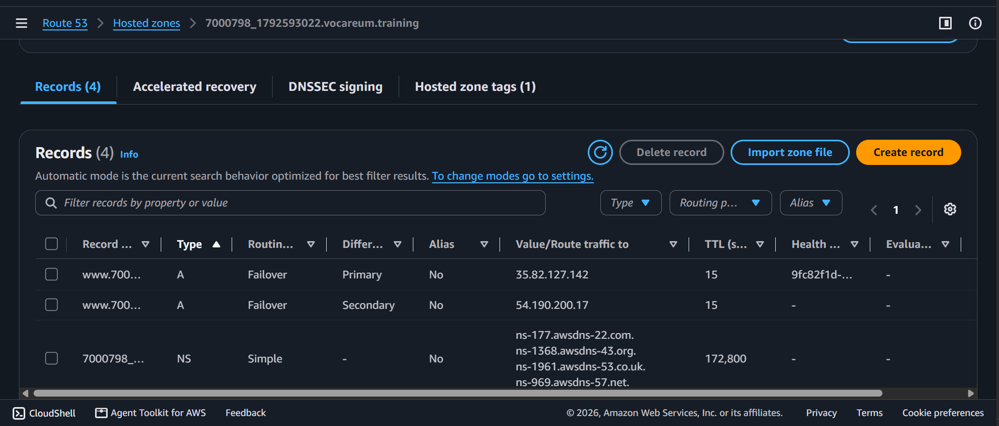
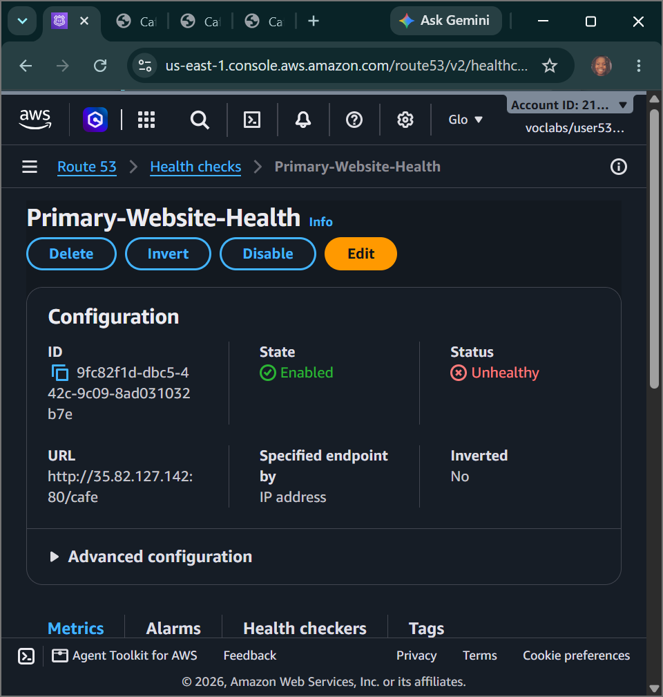
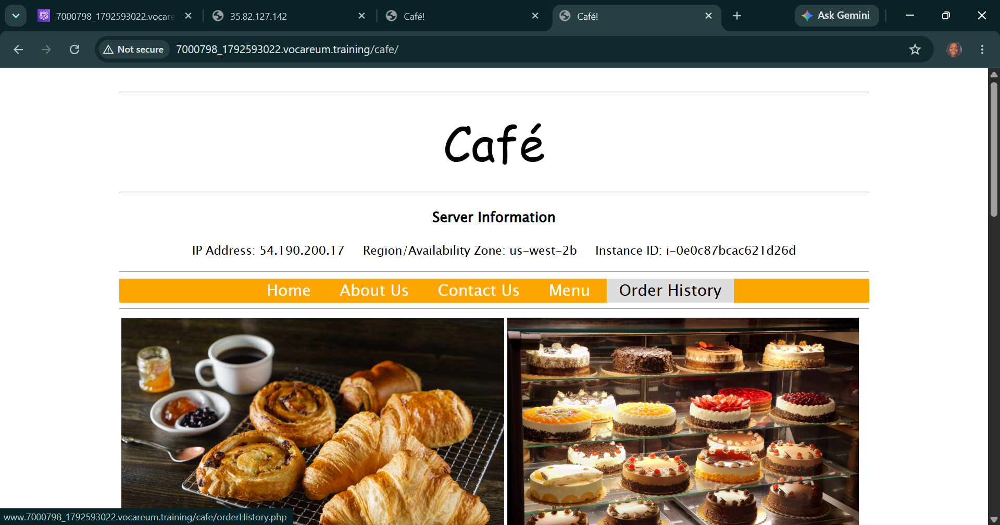

# AWS Cloud Architecture: Amazon Route 53 - Active-Passive DNS Failover, End-to-End HTTP Health Probes & Automated Simple Notification Service (SNS) Telemetry Alarms

## 📌 Section Overview
This module documents the practical architectural implementation, endpoint health monitoring parameters, and cross-zone traffic mitigation strategies that define **Amazon Route 53 DNS Failover Topologies** inside high-availability cloud frameworks. To evaluate how global routing policies maintain continuous application uptime during catastrophic server failures, we engineered continuous HTTP resource health checks, deployed an automated **Amazon SNS** email notification subscriber pipeline, configured primary/secondary record sets inside a custom hosted zone registry, and executed a forensic shutdown test to verify automated traffic redirection to a standby Availability Zone.

---

## 🚀 The Mechanics of Active-Passive DNS Failover

### 1. Global Anycast Name Resolution & Hosted Zone Basics
Every custom enterprise application relies on a **Hosted Zone** container that matches its branded domain registry. Inside this container, Route 53 hosts name server records (**NS**) to define authority, alongside Start of Authority (**SOA**) blocks. To build fault-tolerant web entry points, instead of using volatile public IP configurations, architects leverage **A (Address) Records** combined with explicit routing logic policies to decide how user data streams traverse multi-zone destinations.

### 2. Proactive Endpoint Monitoring & Rapid Triage Windows
A name server cannot divert user connections away from a broken instance unless it has a way to detect system failures. Route 53 achieves this through **Endpoint Health Checks**:
- **Granular Probing Paths:** The DNS engine fires periodic HTTP connection requests straight to a specific application subdirectory (e.g., querying `http://<IP_ADDRESS>/cafe`) to look for a successful connection status.
- **Fast Request Intervals:** Reducing the query sweep window from the standard 30 seconds down to a **Fast (10 seconds) interval** combined with a tight **Failure Threshold of 2** optimizes response speeds. If a server locks up, it will be flagged as broken in just 20 seconds, preventing user connection timeouts.
- **Amazon SNS Decoupling:** Links the health probe directly to an Amazon Simple Notification Service (SNS) topic module. The moment a threshold breach is registered, SNS automatically pushes real-time system alarm payloads (`ALARM: Primary-Website-Health`) directly to subscribed engineer email boxes.

### 3. Failover Policy Record Routing Rules
To map out an automated high-availability routing swap, engineers configure two identical records sharing the exact same prefix string name (`www`), but split into separate operational layers:
- **The Primary Record:** Maps directly to the active web cluster instance, carrying a strict health check validation binding rule. If the probe returns a healthy state, Route 53 directs 100% of domain queries here.
- **The Secondary Record:** Maps directly to an isolated standby compute instance deployed in a completely separate Availability Zone. It remains completely dark (passive) while the primary node functions normally. The exact second the primary node's health status drops into an unhealthy phase, Route 53 dynamically updates its global name records, redirecting all incoming internet traffic straight to the backup secondary server instance instantly.

---

## 🛠️ Step-by-Step Systems Architecture Implementation Lifecycle

### 1. Environmental Footprint Validation
- Copied the baseline cloud configuration variables (`PrimaryWebSiteURL`, `SecondaryWebsiteURL`) from the lab details menu pool.
- Audited the public IP maps inside the Amazon EC2 console, verifying that `CafeInstance1` was active in Availability Zone **`us-west-2a`** while `CafeInstance2` was running inside **`us-west-2b`**.
- Verified application consistency across both nodes using separate browser tabs.

### 2. Engineering the Proactive HTTP Health Probe
- Navigated to the Amazon Route 53 dashboard, accessed the **Health Checks** sub-menu panel, and initialized `Primary-Website-Health`.
- Configured the parameters to track an IP endpoint targeting the raw `/cafe` path, accelerated the request loop to a 10-second fast interval, and compressed the failure threshold down to 2 consecutive drops.
- Provisioned a new Amazon SNS notification channel to distribute metric alarms, and confirmed the pipeline registration via an external email box subscription handshake.

### 3. Compiling the Failover Routing Record Set
- Opened the account's unique custom hosted zone configuration canvas (`*.vocareum.training`).
- **Primary Setup:** Engineered an A-record matching the `www` name token, pointing its destination to `CafeInstance1IPAddress`, setting the Time-To-Live (TTL) to a fast **15 seconds** to clear caches quickly, and choosing the **Failover Routing Policy** with a **Primary** designation bound to the health check module.
- **Secondary Setup:** Engineered an identical `www` A-record, pointing its destination to `CafeInstance2IPAddress`, and choosing the **Failover Routing Policy** with a **Secondary** designation.

### 4. Executing Forensic Disruptions & Validating Auto-Failover
- Navigated back to the Amazon EC2 instances grid table, selected `CafeInstance1`, and executed a destructive **Stop instance** command to simulate a catastrophic hardware blackout.
- Monitored the Route 53 health checking timeline pane under the Monitoring tab. The engine detected the dead endpoint, breached the failure threshold within minutes, and flipped the status flag to an active red **`Unhealthy`** state.
- Intercepted the automated real-time alert payload delivered straight to the registered engineer mailbox via Amazon SNS.
- **Handshake Verification Result:** Refreshed the custom branded Vocareum entry point domain URL. The page bypassed the dead server entirely, routing traffic cleanly across the private AWS network fabric to render the Café website from **`CafeInstance2`** inside the **`us-west-2b`** Availability Zone with zero application downtime!

---

## 📸 Technical Verification Proofs

### DNS Infrastructure Mapping: Completed Primary and Secondary Failover A-Records Active Inside the Hosted Zone

### Proactive Endpoint Monitoring: CloudWatch Route 53 Health Probe Breaching Threshold and Entering an Unhealthy State

### Automated Cloud Failover: Successful Traffic Redirection Rendering Assets from Standby Availability Zone Nodes

