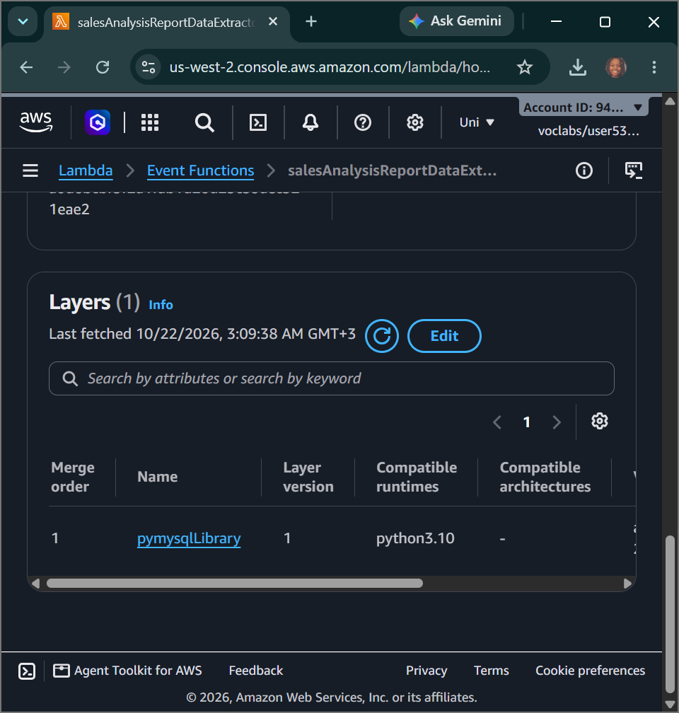
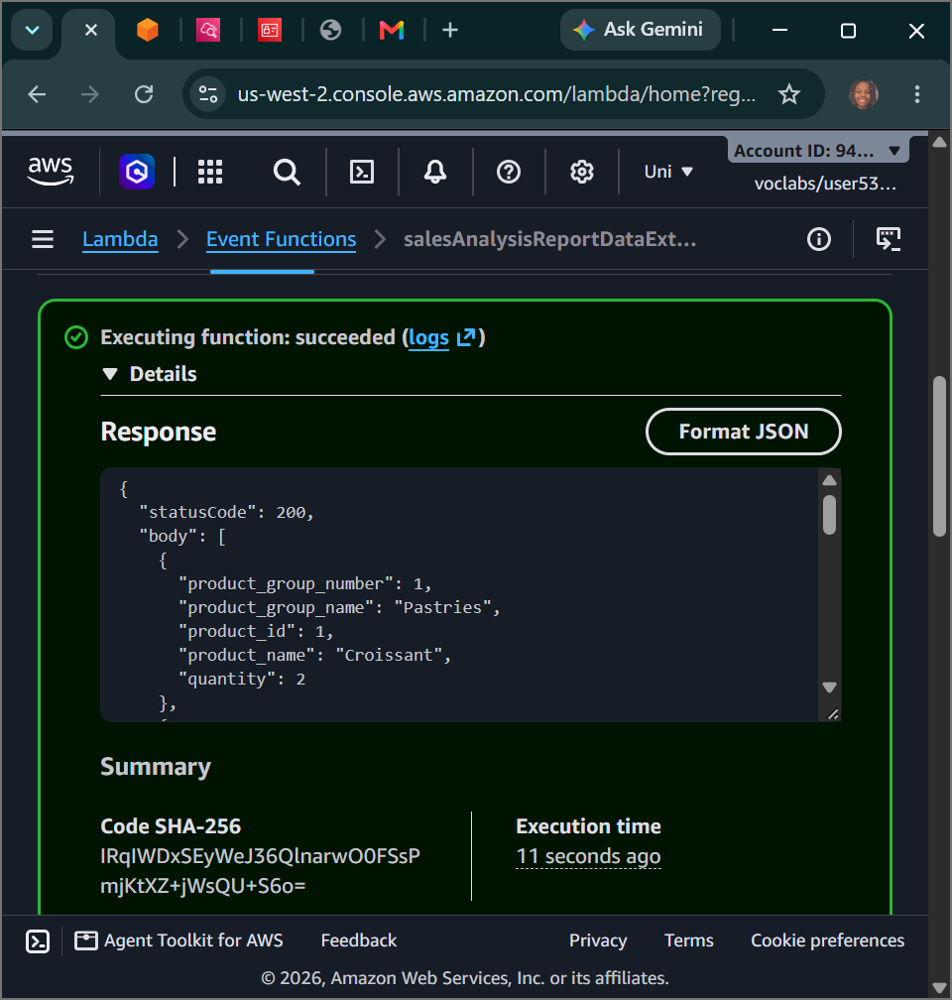
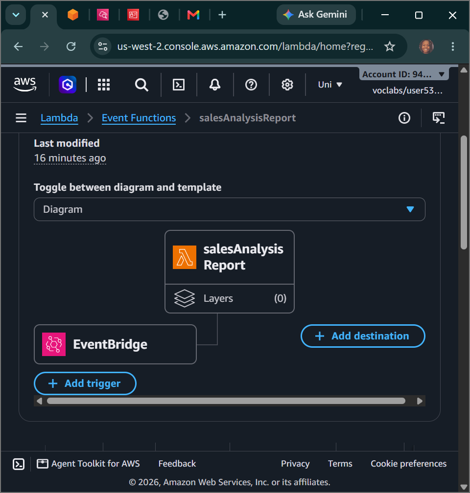

# AWS Cloud Engineering: AWS Lambda Microservices - Event-Driven Serverless Compute, Custom Lambda Layers & Cross-Function API Orchestration

## 📌 Section Overview
This module documents the practical implementation, code-reuse layers, network topology isolation rules, and automated event triggers that define **AWS Lambda Serverless Microservices**. Moving away from traditional virtual machines (EC2) that run idle, we engineered a completely decoupled, event-driven sales reporting architecture. This documentation traces how to build code dependency layers (`pymysqlLibrary`), manage cross-function execution calls via the AWS CLI, troubleshoot port blocks inside private security perimeters, and attach automated **Amazon EventBridge Cron expressions** to fire pipeline workflows on a rigid enterprise schedule.

---

## 🚀 The Serverless Compute Evolution (AWS Lambda)

### 1. Traditional Computing vs. Serverless Paradigms
- **Traditional Server Deployment:** Requires provisioning physical or virtual compute instances, paying for 100% of idle runtime cycles, and constantly tracking security patching, kernel upgrades, and scaling metrics.
- **Serverless Compute (AWS Lambda):** Shifts the entire operational burden to the cloud platform. Engineers upload code blocks natively as independent functions. The underlying compute infrastructure scales instantly and automatically to handle requests, charging strictly for the execution time down to the millisecond, then scales down to zero when traffic stops.

### 2. Advanced Component Optimization: Lambda Layers
- **The Challenge of Code Bloat:** In traditional software engineering, including third-party client drivers (like the open-source `PyMySQL` library) inside every single function's deployment archive drives up package sizes and complicates maintenance loops.
- **The Lambda Layer Solution:** Decouples core business logic from standard external program dependencies. Libraries and dependencies are packaged into a separate zip file matching explicit path structures and uploaded as a global **Lambda Layer**. Functions reference this centralized layer token dynamically at runtime, allowing engineers to reuse identical code libraries across thousands of distinct microservices seamlessly.

---

## 🛠️ Step-by-Step Serverless Ingestion Lifecycle

### 1. Permission Auditing & Trust Boundaries
- Evaluated the IAM roles `salesAnalysisReportRole` and `salesAnalysisReportDERole` using the management console, confirming that `://amazonaws.com` was mapped as an authoritative trusted entity to allow the Lambda engine to invoke resources safely.
- Audited policy access tokens, verifying permissions mapping `AWSLambdaBasicRunRole` for CloudWatch logging along with `AWSLambdaVPCAccessRunRole` to manage Elastic Network Interfaces (ENIs) across private subnets.

### 2. Layer Engineering and Extractor Compilation
- Initialized a custom Lambda layer labeled **`pymysqlLibrary`** under a Python 3.9 runtime, uploading the pre-packaged zip bundle containing the database connection modules.
- Authored the **`salesAnalysisReportDataExtractor`** function from scratch, attached the custom dependency layer, altered the handler script path, and imported the core backend database extraction logic.
- **VPC Subnet Placement:** Mapped the network settings to anchor the serverless function interface directly inside `Cafe Public Subnet 1` and bound the firewall traffic constraints to `CafeSecurityGroup` to isolate communications.

### 3. Forensic Database Timeout Triage
- Extracted connection strings (`/cafe/dbUrl`, etc.) from the Systems Manager Parameter Store and generated an initial test event payload (`SARDETestEvent`).
- **The Failure:** The initial execution crashed with a hard timeout alert: `Task timed out after 3.00 seconds`.
- **Root-Cause Analysis:** The function was attempting to handshake with a MySQL engine sitting inside an EC2 instance, but the instance’s network security group lacked an inbound rule for **TCP Port 3306**. The database client dropped the packets silently, causing a timeout block.
- **Remediation:** Appended an inbound rule opening port **3306** within the target security group. Upon re-testing, the execution status switched to a green success code, extracting rows populated via the café application front-end interface smoothly.

### 4. Cross-Function CLI Deployment & Event Scheduling
- Generated an Amazon SNS messaging pipeline topic named **`salesAnalysisReportTopic`** to handle global email distributions.
- Authenticated your local CLI terminal shell inside the `CLI Host` instance and programmatically provisioned the primary driver function using strict API parameters:
  ```bash
  aws lambda create-function \
    --function-name salesAnalysisReport \
    --runtime python3.9 \
    --zip-file fileb://salesAnalysisReport-v2.zip \
    --handler salesAnalysisReport.lambda_handler \
    --region us-west-2 \
    --role arn:aws:iam::038946776283:role/salesAnalysisReportRole
  ```
- Injected the target SNS topic destination string as a local environment variable (`topicARN`), tested execution flows, and confirmed successful daily sales analysis distribution to external email boxes.
- **Automated Chron Triggering:** Attached an upstream **Amazon EventBridge (CloudWatch Events) trigger rule** using advanced server cron expression formats to fully automate the reporting pipeline lifecycle:
  ```text
  cron(35 11 ? * MON-SAT *)
  ```

---

## 📸 Technical Verification Proofs

### Dependency Decoupling: Custom PyMySQL Library Layer Fully Integrated into the Extractor Function


### Database Integration Success: Successful Extractor Execution Processing Relational Café Rows


### Automated Event Pipeline: EventBridge Trigger Mapped with Custom Cron Scheduling Expressions

