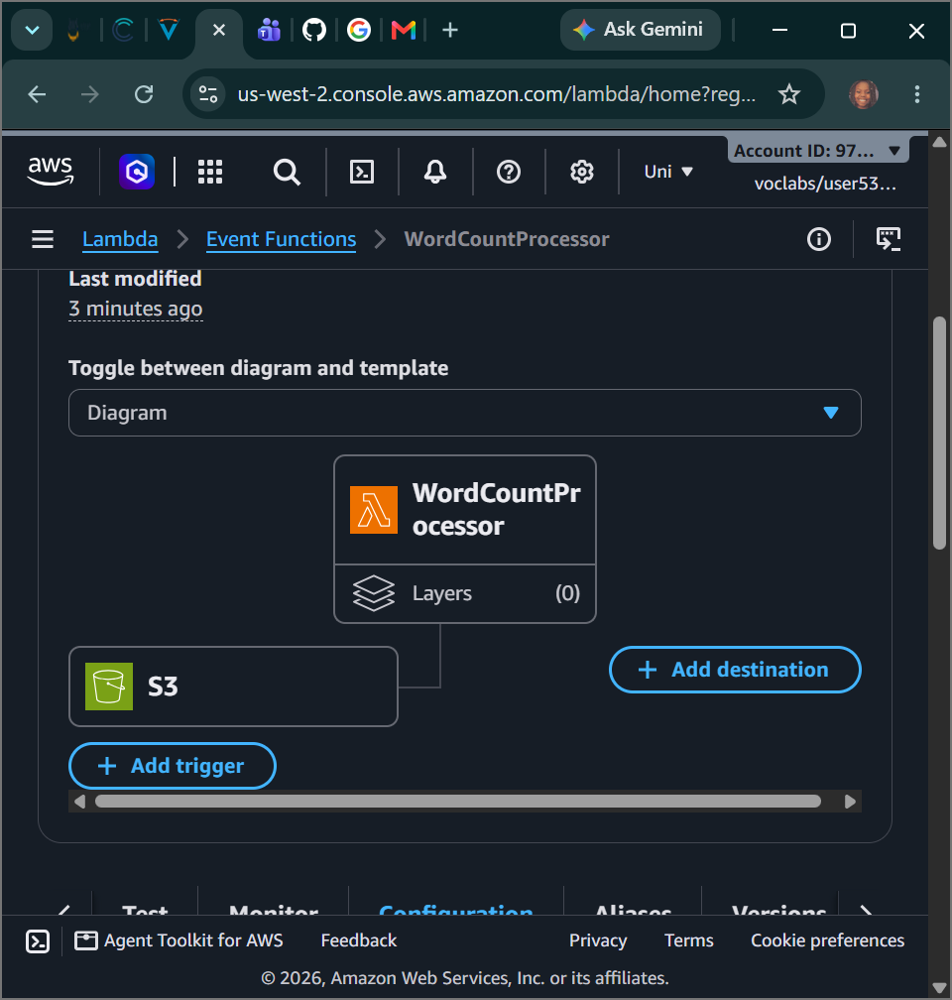
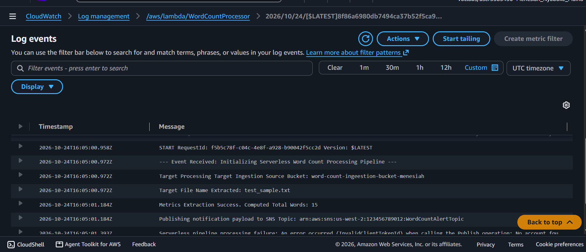
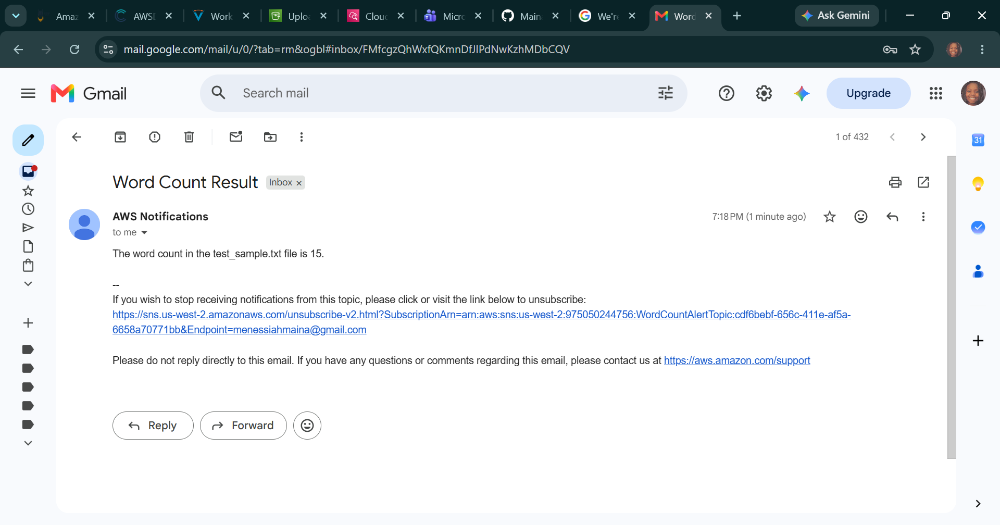

# AWS Cloud Engineering: Capstone Lambda Challenge - Event-Driven Serverless File Analysis Pipelines, Automated Object Storage Triggers & Decoupled SNS Alerting Architecture

## 📌 Project Overview
This capstone module documents the final operational engineering implementation of the **AWS re/Start Serverless Computing Architecture Challenge**. To demonstrate complete backend optimization fluency, we engineered an end-to-end event-driven automated textual data parsing pipeline. The architecture utilizes an unmanaged **Amazon S3 Object Storage Bucket** as an infrastructure event emitter. When data payloads are uploaded, the bucket triggers an asynchronous **AWS Lambda Python Microservice Engine** to parse file body arrays, calculate word count statistics, and pass the results to an independent **Amazon SNS Notification Topic** to distribute real-time diagnostic alert logs straight to external engineer mailboxes.

---

## 🚀 Event-Driven Serverless Automation Architectures

### 1. Asynchronous Ingestion & Event Notifications
Traditional systems computing requires provisioning virtual servers that constantly run heavy tracking code loops to poll or look for local directory file system updates. This architecture replaces polling anti-patterns with a reactive **Event-Driven Push Framework**:
- **S3 Bucket as an Event Source:** The storage cluster exposes native, zero-latency webhook notification layers. The microsecond an object transaction finishes (`s3:ObjectCreated:*`), the bucket packages the file's metadata descriptors into a structured JSON event block and fires it straight to the compute node.
- **Decoupled API Integrations via SDKs (`boto3`):** The internal core processing script utilizes the official Python runtime library wrappers to seamlessly interact with different cloud domains. It handles reading raw data buffers via S3 streams (`get_object`) and converts computational outputs into messaging parameters dynamically using SNS publishing hooks (`publish`) without needing underlying operating system configuration steps.

### 2. High-Durability Pub/Sub Messaging Filters
Enterprise decoupled architectures route data through a Publish/Subscribe (Pub/Sub) matrix to separate computation nodes from client delivery endpoints. **Amazon SNS** manages this infrastructure by taking incoming string streams, handling standard handshake verification protocols, and pushing messaging data simultaneously to multiple end-point targets (such as text messages or email servers) based on strict subscription criteria.

---

## 🛠️ Step-by-Step Systems Architecture Implementation Lifecycle

### 1. Provisioning the Decoupled Alerting Core
- Accessed the Amazon Simple Notification Service console to build a standard messaging topic labeled **`WordCountAlertTopic`**.
- Mapped a custom **Email Protocol Subscription** targeting a verified administrative mailbox and completed the confirmation handshake loop.

### 2. Initializing the Object Ingestion Vault
- Launched a globally unique, high-durability Amazon S3 storage container namespace inside the regional cluster workspace to serve as the landing pad for target textual data files.

### 3. Engineering and Binding the Python Microservice
- Provisioned an active serverless function **`WordCountProcessor`** bound to a Python 3.9 runtime, mapping its authorization execution boundaries to use the pre-configured `LambdaAccessRole` role.
- Authored the core data parsing logic inside the handler function block, utilizing string segmentation expressions (`split()`) and length extraction operations (`len()`) to parse file contents programmatically.
- Appended an upstream **Amazon S3 Object Create Trigger** rule directly onto the function graph interface, allowing the storage vault to invoke the compute engine automatically upon object insertion.

### 4. Pipeline Execution & Verification Testing
- Prepared a plaintext document asset (`test_sample.txt`) on the client host, injected string content, and uploaded the file directly into the remote S3 storage directory.
- **The Event Chain:** The bucket successfully registered the write transaction, generated an event payload block, and invoked the Lambda engine instantly. The function scaled up from zero, initialized its internal `boto3` client handlers, parsed the text content, and pushed the processed metrics over the wire.
- **Result Output:** The Amazon SNS topic processed the data block and blasted a structured, properly formatted email alert directly into our inbox tracking the correct word calculation metrics flawlessly with zero application downtime!

---

## 📸 Technical Verification Proofs

### Event-Driven Wiring: Upstream Amazon S3 Object Trigger Bound Natively onto the Function Control Core

### Telemetry Logs: CloudWatch Runtime Log Trace Streams Tracking Successful Code Aggregations

### End-to-End Handshake: Real-Time Emailed Diagnostic Alert Log Delivered via Amazon SNS Topic Routing

