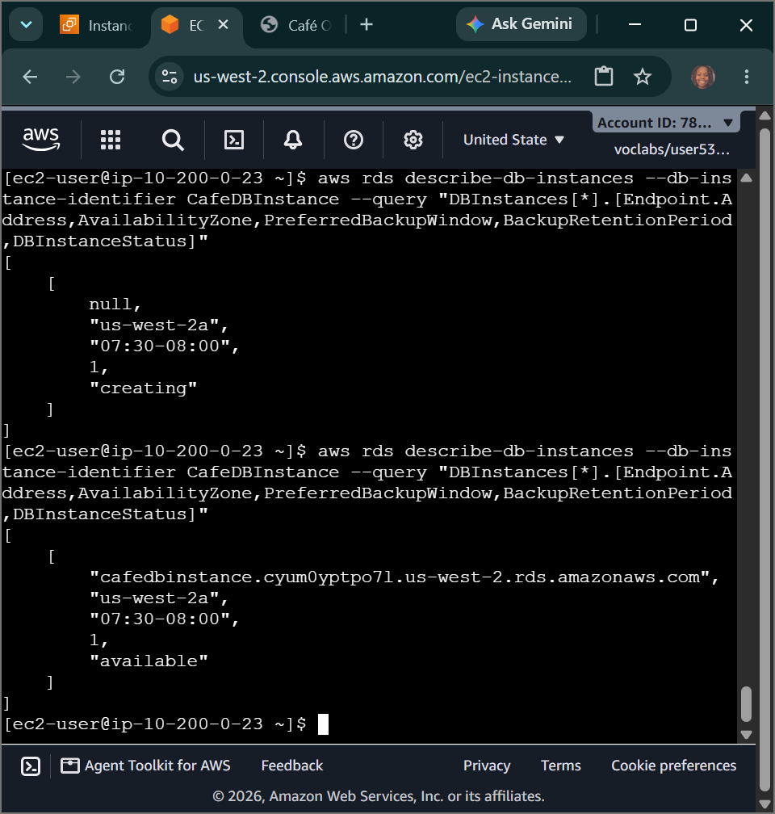
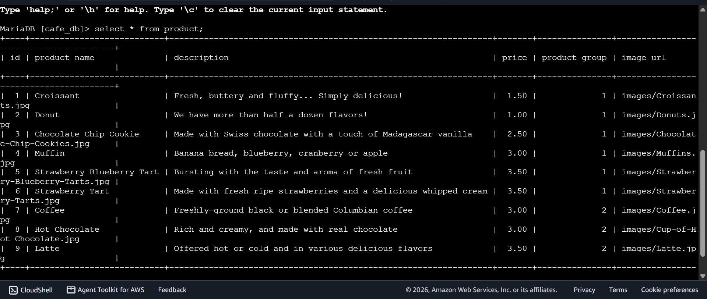
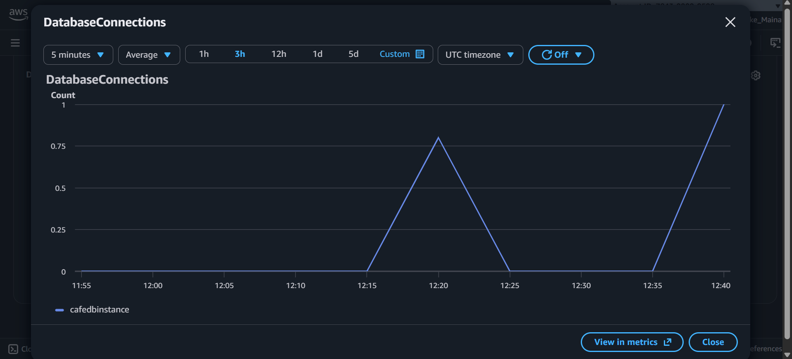

# AWS Cloud Engineering: Migrating to Amazon RDS - Programmatic DB Instance Provisioning, Logical Volume Data Migration & Parameter-Driven Decoupled Cutover

## 📌 Section Overview
This module documents the practical infrastructure execution of **Programmatic Relational Database Provisioning, Logical Storage Data Migrations, SSL Truststore Configurations, and Dynamic Parameter Database Cutovers** within an active enterprise multi-tier application system [1.1]. To eliminate the reliability and scaling limitations of running a localized database inside a tightly coupled single-server architecture, we utilized the AWS CLI to engineer isolated private network subnet groups, launched an independent managed **Amazon RDS MariaDB instance**, executed data extractions via text-stream log dumping (`mysqldump`), and dynamically transitioned production live web application access paths using the **AWS Systems Manager Parameter Store** with zero code structural refactoring.

---

## 🚀 The Managed Decoupled Database Paradigm

### 1. Moving past Monolithic Tightly Coupled Architectures
Traditional entry-level systems engineering models deploy the application code, the web engine process daemon, and the database data engine all within the exact same virtual compute instance container [1.1]. While simple to prototype, this represents a dangerous single point of failure. If user web traffic utilization spikes and exhausts server CPU limits, the underlying database process locks up, causing severe data write corruption loops.

### 2. Multi-Tier Decoupling and Managed Isolation
Decoupling the database tier out of the compute layer onto a dedicated **Amazon RDS managed database engine** stabilizes the complete enterprise application landscape [1.1]:
- **Network Isolation:** The database is locked entirely within **Private Subnets** with public visibility deactivated, making it unreachable by public web crawling scans.
- **Firewall Cascading:** The database security group firewall (`CafeDatabaseSG`) is configured to accept connection traffic *strictly* if the request token maps port **3306 (MySQL/MariaDB)** and originates directly from resources bound to the web layer's `CafeSecurityGroup`.
- **Administrative Offloading:** AWS handles automated point-in-time state backups, daily patch cycles, and storage volume expansions natively [1.1].

---

## 🛠️ Step-by-Step Data Engineering Migration Lifecycle

### 1. Ingestion Boundary Provisioning (Prerequisites)
- Initialized an execution profiling environment inside the `CLI Host` console using secure encrypted instance connect channels.
- Generated the database network firewall barrier `CafeDatabaseSG` inside the custom `CafeVpcID` container, authoring an inbound permission rule targeting TCP port 3306 cascaded from the web tier group ID.
- Formulated two independent database subnets (`10.200.2.0/23` and `10.200.10.0/23`) across multi-AZ boundaries to engineer an active high-availability **DB Subnet Group**.

### 2. Launching the Managed RDS MariaDB Engine
- Executed a programmatic command line query string (`aws rds create-db-instance`) to instantiate a fully managed `db.t3.micro` MariaDB cluster node [1.1].
- Monitored instance creation status via descriptive JSON query loops until the cloud state engine transitioned into a green **`available`** check string, copying down the unique host endpoint link string token: `://amazonaws.com` [1.1].

### 3. Logical Storage Migration & Encryption Truststore Ingestion
- Authenticated straight inside the core local web application instance layer.
- Executed a logical data storage extraction dump command to map the complete original sales schema and index parameters directly into a plaintext text script file object:
  ```bash
  mysqldump --user=root --password='Re:Start!9' --databases cafe_db --add-drop-database > cafedb-backup.sql
  ```
- Pulled down the centralized root truststore certificate bundle (`global-bundle.pem`) to satisfy the managed database engine’s mandatory encrypted SSL/TLS connection perimeter rules.
- Streamed the backup file contents straight across the private network interface over port 3306 to write the rows cleanly onto the remote RDS memory blocks. Handshaked into an active interactive session to confirm row matching integrity loops.

### 4. Dynamic Decoupled Cutover & Telemetry Monitoring
- Accessed the **AWS Systems Manager Parameter Store** configuration hub.
- Located the central database destination indicator string parameter key: `/cafe/dbUrl`. 
- Modified its value to target your newly generated **RDS Instance Database Endpoint Address** string token. The live application frontend automatically intercepted the modification, instantly routing live traffic requests to the managed storage instance without needing an application code change or system restart!
- **CloudWatch Telemetry Audit:** Triggered live connection requests across the web interface and monitored results inside the RDS panel. Amazon CloudWatch successfully captured the metrics tracking an explicit real-time increase from 0 to 1 inside the `DatabaseConnections` monitoring pool, proving successful multi-tier system migration.

---

## 📸 Technical Verification Proofs

### Infrastructure Automation: Programmatic Managed RDS MariaDB Cluster Available Provisioning Telemetry


### Data Migration Integrity: Interrogating the Remote RDS Node to Confirm Row Matching Success


### Live Cloud Monitoring: Tracking Connection Traffic Metrics Real-Time via Integrated CloudWatch Graphs

