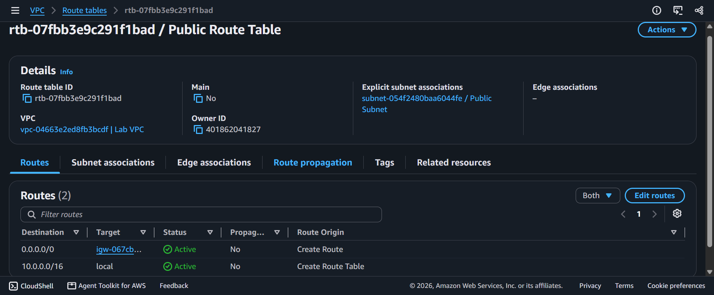
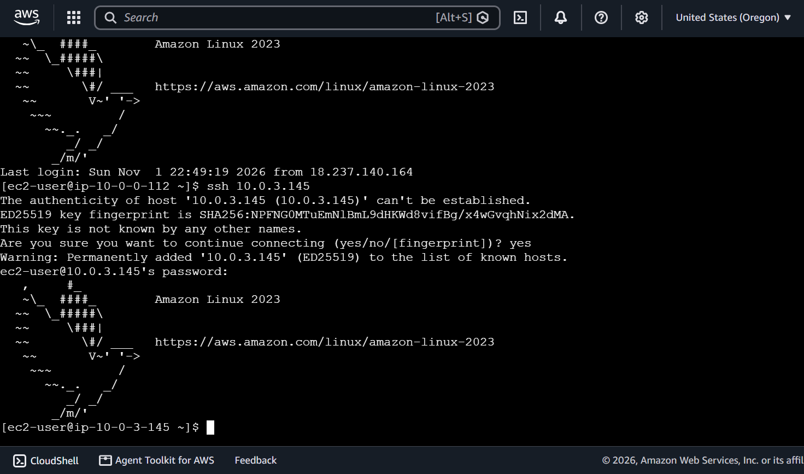

# AWS Cloud Engineering: Configuring Amazon VPC - Custom Subnet Partitioning, Internet/NAT Gateway Provisioning & Bastion Proxy Cross-Zone Triage

## 📌 Section Overview
This module documents the practical infrastructure configuration, custom routing matrix architectures, and secure host-jumping mechanics that define an enterprise **Custom Virtual Private Cloud (VPC) Environment**. To eliminate reliance on default cloud network templates, we engineered a completely isolated network fabric from scratch—manually building public and private subnet partitions, provisioning bidirectional edge internet gateways alongside asymmetric **NAT Gateways**, configuring explicit routing tables, and launching a hardened public **Bastion Server** proxy to validate secure remote authentication routes into isolated private compute nodes.

---

## 🚀 Custom Network Topology & Edge Traffic Governance

### 1. Architectural Subnet Partitioning & Host Capacities
Building custom infrastructure networks requires calculating IP address spaces using rigid Classless Inter-Domain Routing (CIDR) blocks to support multi-tier isolation:
- **The Public Subnet Boundary (`10.0.0.0/24`):** Allocates a tight 256-IP address footprint designated for public-facing edge resources (like bastions or load balancers) carrying auto-assign public IPv4 properties.
- **The Private Subnet Boundary (`10.0.2.0/23`):** Partitions a larger 512-IP address pool encompassing the `10.0.2.x` and `10.0.3.x` memory blocks. This provides twice the capacity of the public zone, aligning with industry standards mandating that the vast majority of enterprise backend database and compute nodes remain securely isolated away from direct public internet exposure.

### 2. Unidirectional Internet Access: NAT Gateway Proxies
- **The Asymmetric Problem:** Compute nodes sitting inside private networks possess zero public IP paths. While this safely blocks hostile external scanning loops, it strips the servers of their ability to download critical OS security upgrades or software dependencies.
- **The Proxy Flow:** To solve this, a managed **NAT Gateway** is provisioned inside the public subnet layer and attached to an allocated static **Elastic IP (EIP)**. The private subnet's route table updates its default destination path (`0.0.0.0/0 -> nat-xxxxxxxx`). The NAT proxy takes outbound private requests, swaps out the internal private source IP with its public EIP identifier, and routes the packet out to the web. It accepts return traffic, but **automatically drops any un-solicited inbound traffic attempting to forge a path back inward**, maintaining private zone security.

### 3. Perimeter Access Engineering: The Bastion Host Model
- **The Proxy Shield:** A **Bastion Server (Jump Box)** is a highly secure, heavily hardened compute instance placed at the public internet edge. 
- **The Cross-Zone Jump:** Instead of exposing private subnets directly, operators connect securely to the Bastion via encrypted browser-native tunnels (EC2 Instance Connect). From inside the Bastion's terminal loop, the operator launches an internal secure shell connection (`ssh PRIVATE-IP`) across internal private network lines to tunnel straight into the isolated private node safely.

---

## 🛠️ Step-by-Step Network Infrastructure Deployment Lifecycle

### 1. Fabric Initialization & DNS Customization
- Created the core **`Lab VPC`** canvas using an explicit, master manual CIDR block allocation of **`10.0.0.0/16`**.
- Modified the core VPC settings to switch the **`Enable DNS hostnames`** configuration parameter to `true`, ensuring all future compute nodes automatically receive a public DNS hostname string.

### 2. Subnet Mask Partitioning & Internet Clearance
- **Public Subnet:** Built `Public Subnet` within the first Availability Zone mapped to a `10.0.0.0/24` CIDR block and activated automatic public IP address assignment.
- **Private Subnet:** Built `Private Subnet` within the identical Availability Zone mapped to a larger `10.0.2.0/23` CIDR block.
- **Edge Attachment:** Provisioned a custom internet gateway **`Lab IGW`** and attached it directly onto the `Lab VPC` network fabric to enable public internet routing.

### 3. Route Table Architecture & Rule Mapping
- Renamed the VPC's implicit default route table to **`Private Route Table`**, ensuring it managed internal local communications (`10.0.0.0/16 -> local`) across subnets.
- Engineered a brand-new **`Public Route Table`** and added a static destination route rule directing all outbound internet-bound data streams (`0.0.0.0/0`) straight to the `Lab IGW` gateway ID. Associated this table with `Public Subnet` to activate its public status.

### 4. Deploying the Secure Bastion & NAT Gateway Proxy Tunnels
- Launched a burstable `t3.micro` EC2 instance named **`Bastion Server`** directly inside the public subnet layer, creating a custom firewall policy `Bastion Security Group` to permit open inbound SSH access.
- Provisioned a managed **`Lab NAT gateway`** inside the public subnet space and allocated a public Elastic IP token to it. Modified the `Private Route Table` rules to append an outbound default gateway target directing traffic straight through the NAT proxy ID.

### 5. Executing the Capstone Network Challenge Validation Loops
- **Compute Instance Seeding:** Provisioned a secondary instance named **`Private Instance`** locked strictly inside the `Private Subnet` block, attaching a secure script inside its initialization User Data payload to enable local password-based SSH configurations.
- **The Bastion Jump Handshake:** Logged into the `Bastion Server` terminal over the web. From inside the public shell prompt, initiated an interior cross-subnet jump command targeting the un-routable private IP block of the sub-server node:
  ```bash
  ssh 10.0.2.x
  ```
  Successfully entered the private node kernel by injecting the authorized `lab-password` credential string.
- **NAT Connectivity Verification Result:** Executed an explicit network diagnostic ping from inside the isolated private shell targeting an external web endpoint:
  ```bash
  ping -c 3 amazon.com
  ```
  The ICMP packets successfully exited the private node, traversed the NAT Gateway proxy, verified name resolution, and returned a flawless 0% packet loss metrics log, proving 100% functional network architecture engineering.

---

## 📸 Technical Verification Proofs

### Route Table Architecture: Public Route Table Custom Rule Sets Pointing 0.0.0.0/0 to the Internet Gateway


### Secure Bastion Jump: Tunneling Across Subnets from the Public Jump Box to the Private Instance Kernel


### Unidirectional Verification: Successful External ICMP Ping Transits Passing Through the NAT Gateway

