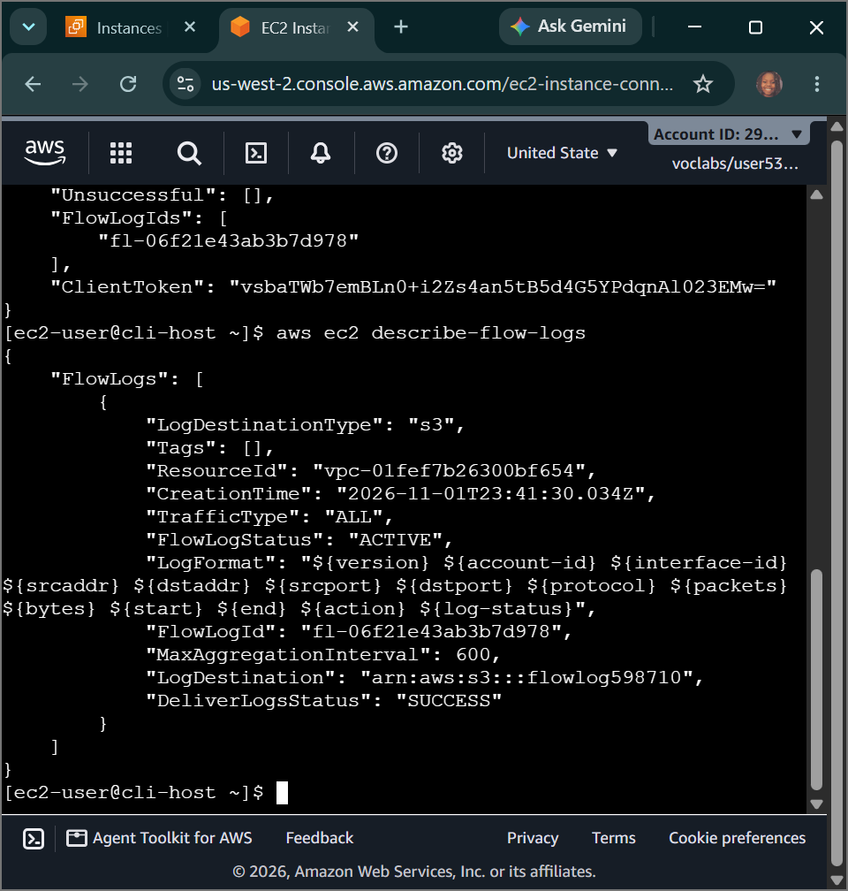
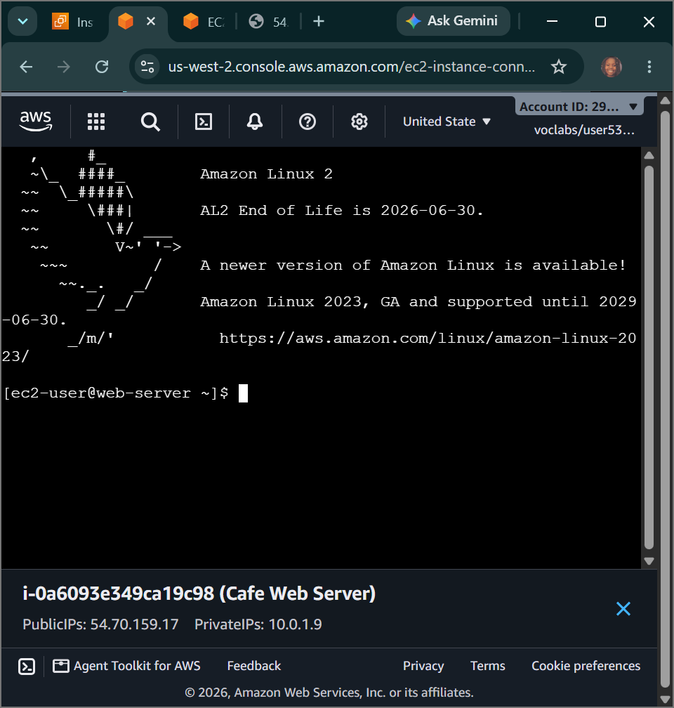
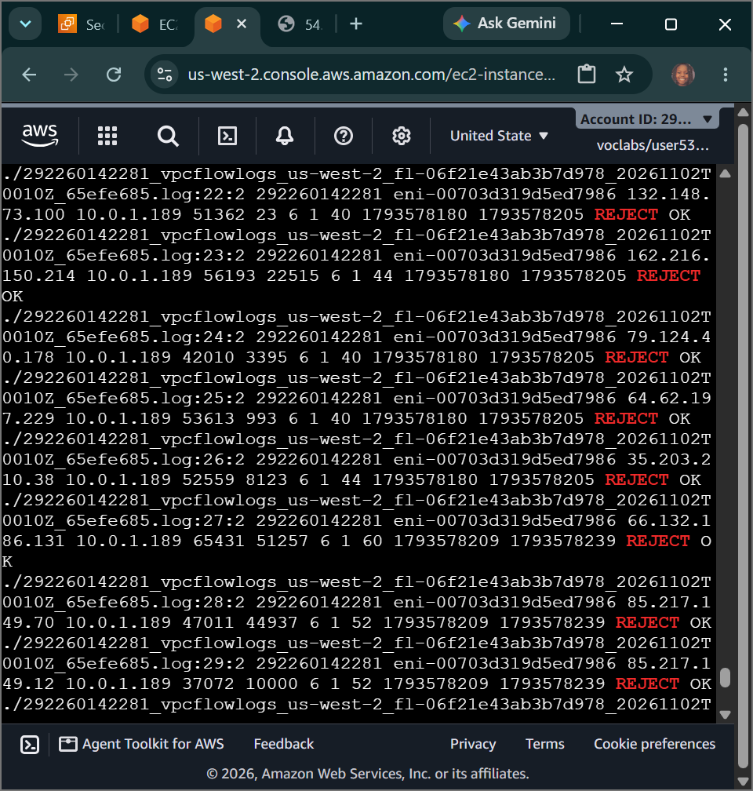

# AWS Cloud Engineering: Troubleshooting a VPC - Network Forensic Telemetry, Stateless NACL Remediation, and VPC Flow Log Data Stream Dissection

## 📌 Section Overview
This module documents the practical implementation of **Cloud Network Forensic Telemetry, Stateless Firewall Remediations, and VPC Flow Log Data Stream Dissection** within an enterprise cloud networking matrix. To evaluate how packet-level data captures and configuration architecture drifts impact system operations, we provisioned an active **VPC Flow Logs** collection pipeline streaming data blocks directly into an **Amazon S3 data lake**, executed programmatic CLI commands to locate and resolve multiple multi-tier network connectivity failures, and utilized native Linux regex parsing engines to unpack and audit raw compressed traffic records for terminal forensics.

---

## 🚀 Architectural Breakdown of the Forensic Investigations

### 1. Troubleshooting Challenge #1: Resolving the Routing Layer Drift
- **The Symptom:** The Web Server instance was confirmed as active and running inside the public network partition (`VPC1`), yet all external web browser requests targeting its public IPv4 address timed out with a hard `ERR_CONNECTION_TIMED_OUT` error.
- **The Forensic Triage:** Running network port scans (`nmap`) via the CLI Host failed to locate any open ports. Investigating the subnet's edge routing infrastructure via `aws ec2 describe-route-tables` revealed that the public route table lacked a default gateway route entry pointing to the internet gateway.
- **The Remediation:** Executed an explicit programmatic command to inject the missing destination rule, mapping the edge gateway token into the public routing configuration table securely:
  ```bash
  aws ec2 create-route --route-table-id rtb-xxxx --destination-cidr-block 0.0.0.0/0 --gateway-id igw-xxxx
  ```
- **The Result:** The routing block cleared instantly, enabling data packets to transit the VPC edge, causing the browser to render the live web server homepage successfully.

### 2. Troubleshooting Challenge #2: Overriding Stateless Firewall Interceptions
- **The Symptom:** While HTTP public web traffic functioned perfectly, attempting to establish an administrative remote connection via EC2 Instance Connect crashed with a persistent `Failed to connect to your instance` error block.
- **The Forensic Triage:** Confirmed that the instance's stateful Security Group correctly contained an inbound rule allowing TCP Port 22 (SSH). Shifted the diagnostic focus upward to the subnet perimeter layer, running programmatic queries to audit stateless Network Access Control Lists (NACLs):
  ```bash
  aws ec2 describe-network-acls --filter "Name=association.subnet-id,Values='subnet-xxxx'"
  ```
- **The Discovery:** Isolated a rogue, lower-indexed stateless inbound rule entry (**Rule 20**) explicitly configured to evaluate and `DENY` all incoming TCP Port 22 packets. Because NACLs process rules sequentially, Rule 20 intercepted and dropped the SSH handshake traffic before it could hit the lower default rules.
- **The Remediation:** Executed a clean programmatic purge command to slice the blocking rule straight out of the stateless firewall matrix:
  ```bash
  aws ec2 delete-network-acl-entry --network-acl-id acl-xxxx --rule-number 20 --ingress
  ```
- **The Result:** The stateless subnet-level lock was neutralized. The terminal successfully processed the connection keys over EC2 Instance Connect, logging into the node and displaying `web-server` as the active hostname.

---

## ⚙️ Forensic Pipeline Data Dissection: VPC Flow Logs

VPC Flow Logs function as an essential network auditing framework, capturing raw IP traffic metadata flowing across Elastic Network Interfaces (ENIs) inside your virtual network canvas. 

### 1. Log Aggregation and Extraction Processing
Flow log data streams are packed into highly compressed GNU zip archives (`.log.gz`) and securely delivered to target **Amazon S3 data lake storage vaults**. Conducting forensic audits requires pulling down the remote recursive folder trees, moving down the chronological directory paths (`AWSLogs/AccountID/vpcflowlogs/region/yyyy/mm/dd/`), and running terminal extraction engines to strip out compression parameters:
```bash
aws s3 cp s3://flowlog######/ . --recursive && gunzip *.gz
```

### 2. Dissecting the Metadata Schema Payload
Reading the header layout of an extracted flow log file reveals a structured metadata schema tracking packet-level history line-by-line:
```text
version  account-id  interface-id  srcaddr  dstaddr  srcport  dstport  protocol  packets  bytes  start  end  action  log-status
```
- **`srcaddr` & `dstaddr`:** Logs the absolute IPv4/IPv6 source and destination endpoints of the connection.
- **`dstport`:** Identifies the target port requested (e.g., port `22` for SSH or `80` for HTTP).
- **`action` (Forensic Indicator):** Displays **`ACCEPT`** if the traffic passed both NACL and Security Group boundaries successfully, or **`REJECT`** if either firewall layer blocked the connection.
- **Timestamps:** Timestamps are recorded in raw Unix epoch time format (seconds elapsed since January 1, 1970). Translating these values into human-readable corporate logging parameters is handled directly inside the shell kernel environment:
  ```bash
  date -d @1554496931
  ```

### 3. Advanced Regex Streaming Analysis
Rather than scrolling through millions of raw log entries manually, network reliability engineers leverage advanced pipeline queries to isolate explicit threat vectors. By combining structural file searches (`grep`) with stream pipes (`|`) and word count counters (`wc -l`), we tracked down the exact fingerprint of our blocked connection attempts:
```bash
grep -rn 22 . | grep REJECT | grep <your-client-public-ip>
```
This precise command filtered out background network noise, returning the exact number of entries matching the client’s public IP footprint being rejected over port 22, matching our historical connection failure counts.

---

## 📸 Technical Verification Proofs

### Telemetry Pipeline Active: Verification of Functional VPC Flow Log Streams Publishing to the S3 Data Lake


### Security Triage Success: Successful Subnet Jump via EC2 Instance Connect to the Verified Web Server Kernel


### Forensic Log Analysis: Target Match Isolation Capturing Rejected Port 22 Packets Inside Extracted Log Files

