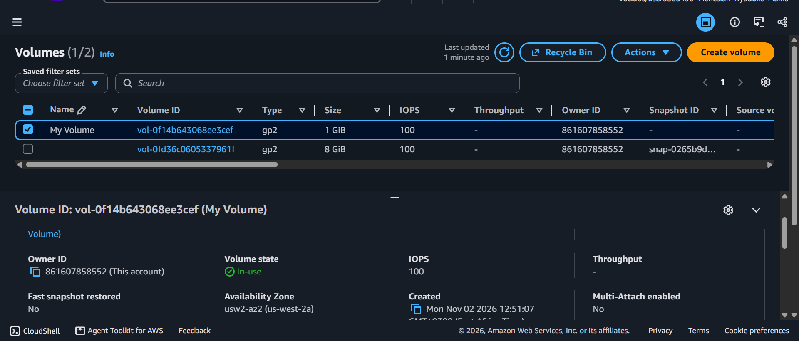
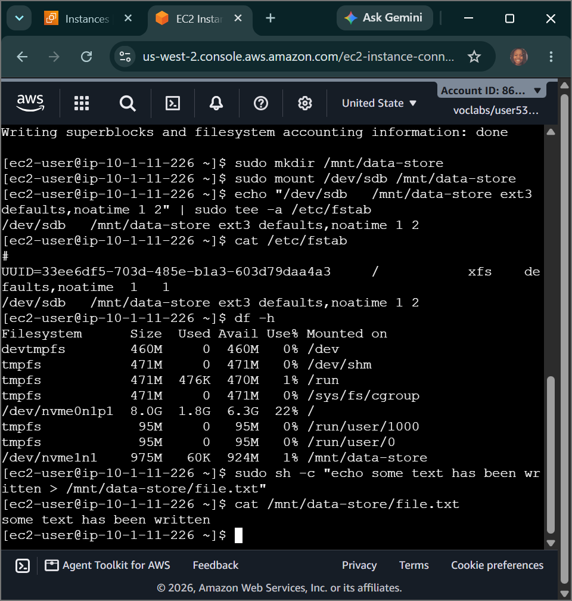
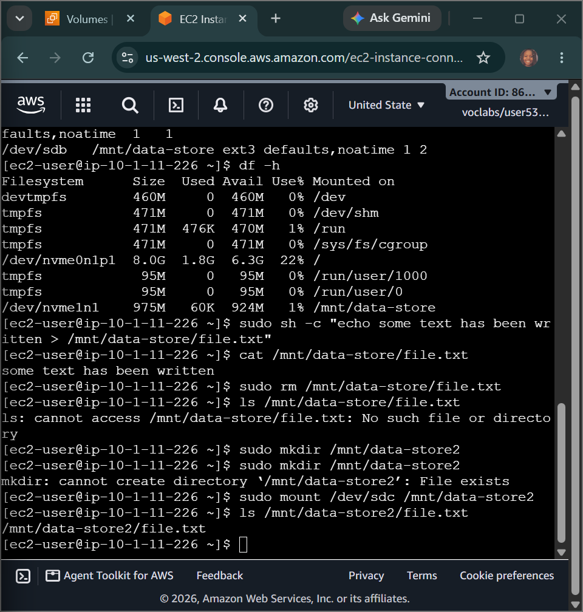

# AWS Cloud Engineering: Managing EBS Blocks & Snapshots -s OS-Level Device Partitioning, ext3 File System Mounts & Point-in-Time Data Recovery Pipelines

## 📌 Section Overview
This module documents the practical engineering implementation of **Raw Block Storage Allocation, Linux Kernel File System Compilation, Persistent Device Mount Trees, and Cryptographic Point-in-Time Snapshot Recovery** inside live cloud environments. To demonstrate complete operational fluency in data persistence management, we provisioned an independent Amazon Elastic Block Store (EBS) solid-state storage volume, attached and mounted it to a running Linux compute node, executed file writing operations, and designed an end-to-end backup snapshot restoration pipeline to recover files successfully after a destructive data-loss erasure event.

---

## 🚀 The Block Storage Architecture Plane (Amazon EBS)

### 1. High-Performance Network-Attached Block Device Mechanics
Unlike object storage arrays that operate as flat web APIs, **Amazon Elastic Block Store (EBS)** functions as a virtual Storage Area Network (SAN) [1.1, 8]. It delivers raw, unformatted blocks of data attached directly to compute instances via high-velocity virtual cables. Because the data passes directly into the operating system's kernel storage controller, it behaves like an internal hard drive, making it the industry standard for hosting high-frequency databases and boot volumes [1.1, 8].

### 2. Matching Volume Types to Workload Demands
Solutions architects tune block infrastructure profiles by aligning disk storage types with explicit application I/O patterns:
- **Solid-State Drives (SSD - gp2/gp3):** Engineered for transactional, latency-sensitive operations. They prioritize **IOPS (Input/Output Operations Per Second)**, making them optimal for database hosting, boot sequences, and development test apps.
- **Hard Disk Drives (HDD - st1/sc1):** Engineered for large-scale, throughput-heavy stream data. They prioritize **MB/s (Throughput Transfer Velocity)**, making them highly cost-effective for streaming massive media files, logging big data analytics, and storing cold backups.

### 3. Cryptographic Incremental Snapshot Topologies
An EBS Snapshot is a point-in-time, block-level copy of a storage volume backed up securely inside Amazon S3. Snapshots are fundamentally **Incremental**:
- *The Initial Snapshot:* Copies 100% of the active used data blocks present on the disk volume.
- *Subsequent Snapshots:* Evaluate modifications and write *only* the specific data blocks carrying text or structural modifications (deltas) since the last execution backup. This slashes cloud storage space consumption and minimizes data pipeline costs.

---

## 🛠️ Step-by-Step Block Storage Lifecycle Implementation

### 1. Provisioning and Binding the Raw Device Volume
- Audited the core compute matrix inside the Amazon EC2 console, isolating the active `Lab` instance to identify its precise Availability Zone constraint (`us-west-2a`).
- Provisioned a new 1 GiB **General Purpose SSD (gp2)** volume named `My Volume`, locking its network availability boundaries to match the instance zone exactly to allow a low-latency connection.
- Dispatched an immediate API link command via the console interface to attach the raw device to the server under the system identifier target path: **`/dev/sdb`**.

### 2. Linux Kernel File System Compilation & Mounting
- Authenticated securely into the instance's active bash prompt via an encrypted web tunnel over EC2 Instance Connect.
- Audited available disk device nodes via the terminal (`df -h`). Formatted the newly bound raw hardware block into a clean Linux-native **ext3 File System structure**:
  ```bash
  sudo mkfs -t ext3 /dev/sdb
  ```
- Created a localized data storage landing directory path (`/mnt/data-store`) and executed an immediate mount command to link the formatted hardware block straight to the directory tree.
- **Enforcing Reboot Persistence:** Piped a structural device mount string directly into the core configuration layout table using the `tee` utility tool to ensure the operating system maintains the file path link after an emergency server restart:
  ```bash
  echo "/dev/sdb   /mnt/data-store ext3 defaults,noatime 1 2" | sudo tee -a /etc/fstab
  ```
- Generated a test document file object (`file.txt`) carrying a plaintext message payload right inside the mounted partition block.

### 3. Snapshot Backup & Forensic Failure Simulation
- Navigated to the EC2 volume panel, selected the active device, and initiated an immediate point-in-time data backup snapshot named **`My Snapshot`**.
- **Simulating Forensic Disaster:** Returned to the active bash console window and executed a destructive administrative removal command to permanently erase the critical text file asset off the drive, confirming the data deletion using directory lookups:
  ```bash
  sudo rm /mnt/data-store/file.txt && ls /mnt/data-store/file.txt
  ```

### 4. Executing Block-Perfect Snapshot Restoration
- **Rebuilding the Drive Volume:** Selected the completed backup asset `My Snapshot`, clicked Actions, and spun up a brand-new storage block volume labeled **`Restored Volume`**.
- **Secondary Device Attaching:** Linked this restored storage block onto the running server instance, mounting it to an independent secondary port connector path: **`/dev/sdc`**.
- **Mount Verification Result:** Created a secondary mounting path node (`/mnt/data-store2`), attached the restored block device, and audited the directory path:
  ```bash
  sudo mkdir /mnt/data-store2 && sudo mount /dev/sdc /mnt/data-store2 && ls /mnt/data-store2/
  ```
- **The Recovery Output:** The terminal processed the commands and cleanly listed **`file.txt`** on screen. Reading its contents verified that the complete plaintext data payload was perfectly preserved and recovered, proving complete mastery over block disaster-recovery frameworks.

---

## 📸 Technical Verification Proofs

### Infrastructure Mounting: Custom 1 GiB Block Volume Successfully Attached and Initialized Natively over the Lab Instance


### Persistent Mount Tree: Storage Volume Formatted to ext3 and Mapped to the Linux Filesystem fstab Table


### Block Disaster Recovery: Successful Recovery of Deleted Application Files via Restored EBS Snapshot Blocks

