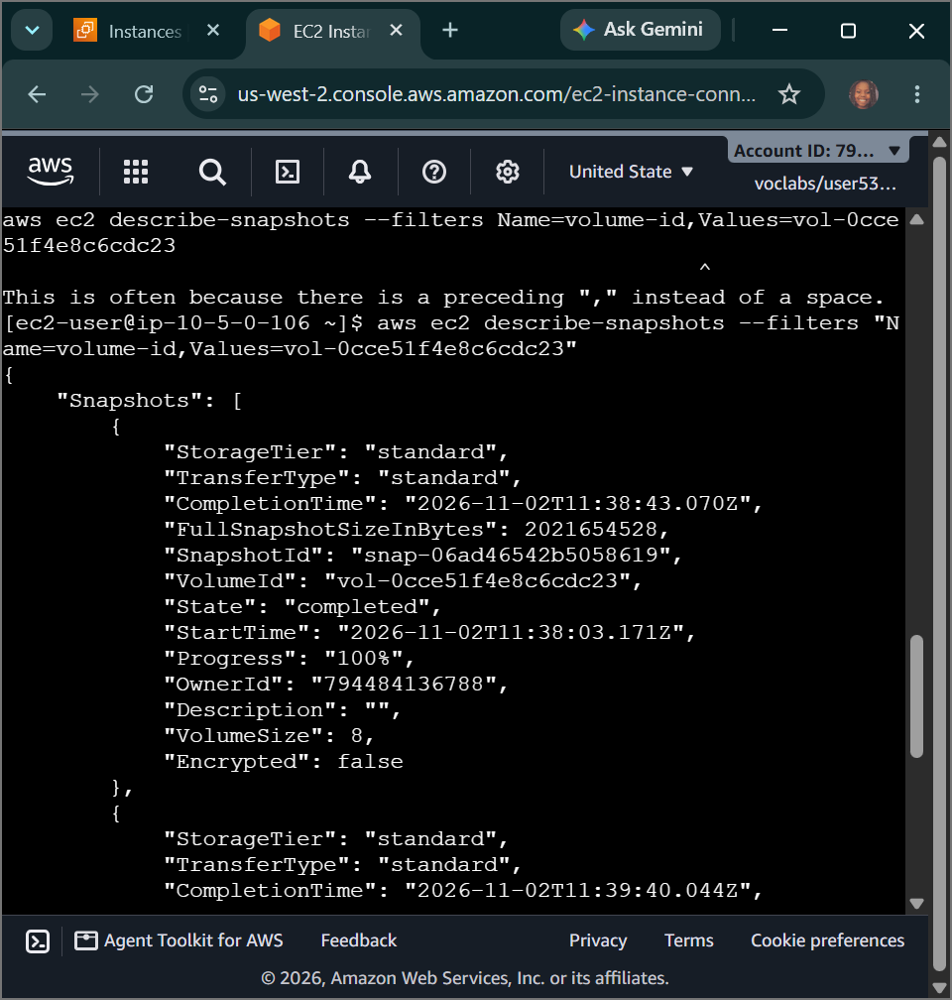
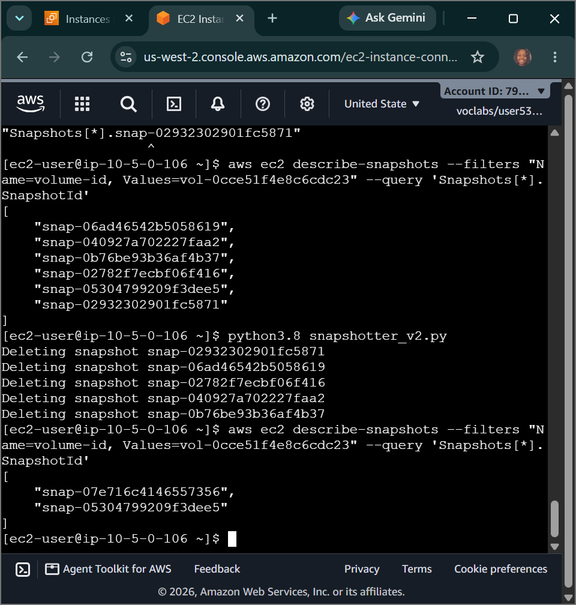
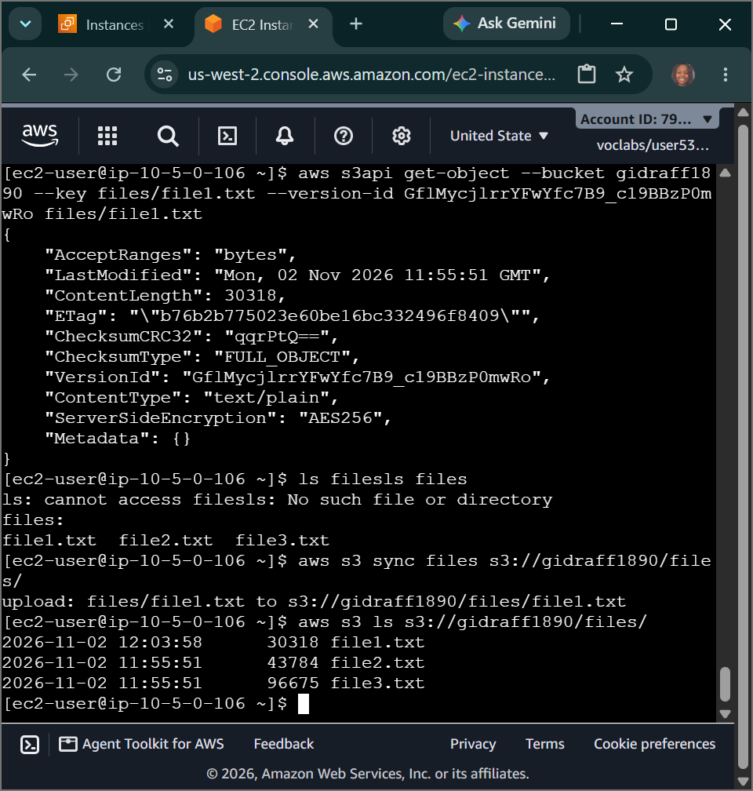

# AWS Cloud Engineering: Managing Storage & Data Lifecycle - Automated EBS Cron Snapshotting, Python Snapshot Pruning & S3 Delta Sync Versioning Recovery

## 📌 Section Overview
This module documents the practical implementation of **Automated Block Level Storage Snapshotting, Programmatic Retention Pruning via Python, Delta Object Synchronization, and S3 Point-in-Time Versioning Data Recovery**. To implement a resilient corporate data lifecycle governance framework, we established a high-frequency automated backup cron scheduler on a live Red Hat Linux instance, executed a custom Python pruning script (`snapshotter_v2.py`) to enforce retention windows, and engineered a zero-downtime delta-optimized data replication stream using `aws s3 sync --delete` to sync volume data into an S3 data lake while leverage versioning tags to recover from a destructive data-loss failure.

---

## 🚀 Automated Block Backup Lifecycles & Retention Management

### 1. Cron Systems Scheduling & Data Integrity
Traditional infrastructure models rely on manual block storage snapshots, creating high operational risk and configuration gaps. Modern cloud operations enforce automation. Utilizing the native Linux **Cron Scheduler** system, we compile precise rule strings (`* * * * *`) that command the operating system kernel to automatically fire asynchronous API requests (`aws ec2 create-snapshot`) every 60 seconds. This provides continuous, granular restore points for data volumes. To ensure full transactional data consistency before taking an initial golden snapshot, compute nodes are gracefully put into a `stopped` state to completely flush out memory caches and freeze file system operations.

### 2. Programmatic Retention Management via Python
Allowing automated backup schedulers to run infinitely creates high cloud storage space bloat and drives up costs. SysOps teams implement programmatic data lifecycles. We deployed a custom Python script module (`snapshotter_v2.py`) that utilizes the **AWS SDK (`boto3`)** to interrogate block storage environments programmatically:
- **The Evaluation Loop:** The script automatically queries the account metadata to isolate active EBS volumes and extracts their full snapshot lineage trees.
- **The Pruning Logic:** It applies chronological sorting arrays to evaluate creation timestamps, preserves the **two most recent snapshots** to satisfy operational recovery boundaries, and programmatically purges all older stale snapshot IDs from the storage disks to optimize cloud budgets.

---

## ⚙️ S3 Delta Synchronization & Versioning Data Recovery

When syncing large application content directories from local storage volumes up to an object storage bucket data lake, running heavy full-copy overrides creates massive network latency and bandwidth costs. Engineers deploy advanced optimization flags:

### 1. Delta-Optimized Replication (`aws s3 sync`)
The `aws s3 sync` engine acts as a differential data transport pipeline. Instead of uploading every individual file, it analyzes timestamps and file sizes between the source local folder and remote S3 paths, transferring **only the specific modified data bytes (deltas)**. 
- **The `--delete` Parameter:** To enforce identical mirroring, appending the `--delete` flag tells the execution client to audit the destination bucket. If a file was deleted locally from the server's drive, S3 will automatically find and delete the corresponding file out of the bucket folder instantly, preventing file drift.

### 2. Forensic Versioning & Delete Marker Bypasses
If a local file is accidentally deleted, a subsequent `sync --delete` command will wipe the asset out of the cloud bucket as well. To prevent catastrophic data loss, buckets activate **S3 Object Versioning**:
- **The Delete Marker Mechanism:** When the sync engine commands S3 to delete the file, S3 does not permanently erase the underlying data blocks. It injects a placeholder known as a **Delete Marker** over the object version stack.
- **Forensic Extraction Recovery:** To recover the data asset, engineers programmatically query the bucket's underlying object ledger version logs using the AWS CLI:
  ```bash
  aws s3api list-object-versions --bucket <bucket-name> --prefix <file-path>
  ```
- By isolating the explicit cryptographic **`VersionId`** created *before* the delete marker was placed, engineers run an administrative fetch override (`aws s3api get-object --version-id`) to download the historical version block directly back to the server, successfully achieving 100% data recovery with zero system downtime.

---

## 🛠️ Step-by-Step Systems Operations Ingestion Lifecycle

### 1. Environment Preparation & Role Binding
- Deployed a unique Amazon S3 storage container namespace (`flowlog######`) via the command line interface to act as our data lake repository.
- Switched to the EC2 panel to modify instance access parameters, attaching the pre-provisioned IAM role **`S3BucketAccess`** as an instance profile to the `Processor` instance to grant secure programmatic API access to the S3 bucket.

### 2. Automated Snapshot Generation & Scripted Pruning
- Handshaked into the `Command Host` bash terminal window pane via secure EC2 Instance Connect web tunnels.
- Extracted the active block volume ID of the `Processor` target using specific client-side query parameters:
  ```bash
  aws ec2 describe-instances --filter 'Name=tag:Name,Values=Processor' --query 'Reservations[0].Instances[0].BlockDeviceMappings[0].Ebs.VolumeId'
  ```
- Executed an administrative stop instance sequence to freeze disk processing memory, took an initial baseline snapshot, and verified completion.
- Restarted the instance and established an active high-frequency background **Cron job** to automate snapshot creation every minute:
  ```bash
  echo "* * * * *  aws ec2 create-snapshot --volume-id vol-xxxx" > cronjob && crontab cronjob
  ```
- Allowed the scheduler to populate multiple backup IDs on disk, then canceled the cron loop (`crontab -r`).
- Invoked the custom Python lifecycle engine (`python3.8 snapshotter_v2.py`). Intercepted the shell telemetry as it successfully parsed creation histories, deleted the stale snapshot mass, and left **exactly two valid recovery snapshots** on the account.

### 3. Executing the Capstone Storage Delta Challenges
- Logged into the `Processor` compute node and downloaded the sample project file package container archive (`files.zip`) using the `wget` web utility.
- Programmatically initialized **S3 Object Versioning** parameters over your unique bucket namespace:
  ```bash
  aws s3api put-bucket-versioning --bucket my-unique-bucket-id --versioning-configuration Status=Enabled
  ```
- Dispatched an initial sync command to stream the unpacked text files up to the bucket folder space (`aws s3 sync files s3://...`).
- **Simulating Data Loss Failure:** Executed a hard deletion command to wipe out `file1.txt` off the local Linux directory, and ran the sync tool with the strict mirror-destruction flag attached:
  ```bash
  rm files/file1.txt && aws s3 sync files s3://my-unique-bucket-id/files/ --delete
  ```
  The terminal trace logs confirmed that the object was forcefully dropped out of the primary bucket directory listing.
- **Executing the Versioning Recovery Loop:** Run an advanced API list call to look behind the active directory and track the historical version ID strings:
  ```bash
  aws s3api list-object-versions --bucket my-unique-bucket-id --prefix files/file1.txt
  ```
  Isolated the valid historical `VersionId` token, and ran an administrative fetch extraction to pull the data straight out of the underlying S3 version stack directly back onto the local disk:
  ```bash
  aws s3api get-object --bucket my-unique-bucket-id --key files/file1.txt --version-id <VERSION-ID> files/file1.txt
  ```
- **The Validation Result:** Audited the local directory using the `ls files` lookup command. The system successfully displayed all three files, proving perfect data recovery from an event-driven delta sync failure.

---

## 📸 Technical Verification Proofs

### Automated Block Schedulers: Cron System Logs Generating Incremental Volume Snapshots Every 60 Seconds


### Programmatic Pruning: Python SDK Scripts Deleting Stale Backups and Enforcing Two-Snapshot Retention Rules


### Versioning Recovery: Programmatically Recovering Deleted Sync Files Directly from the S3 Version Ledger Stack

