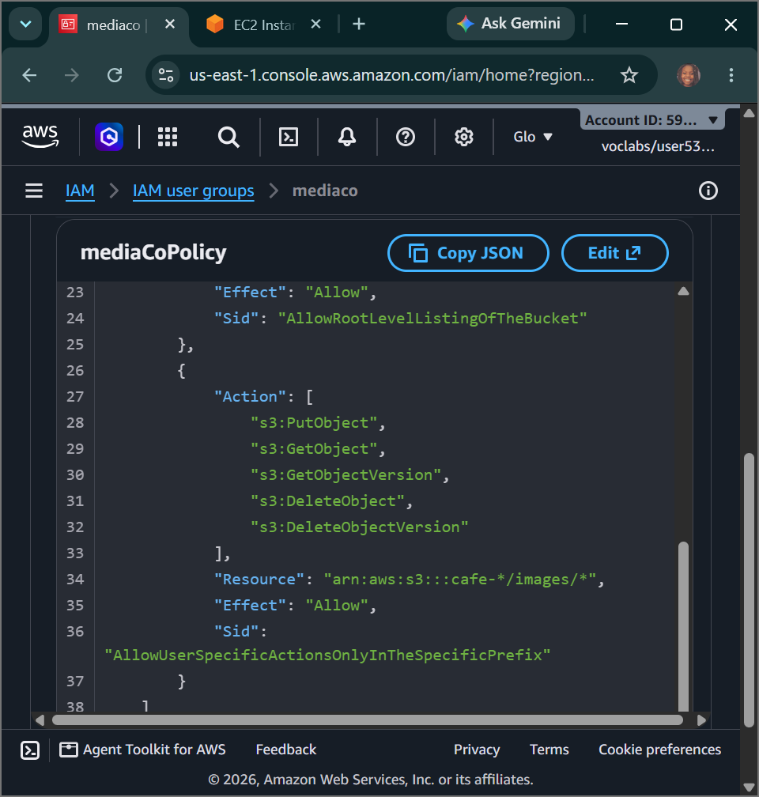
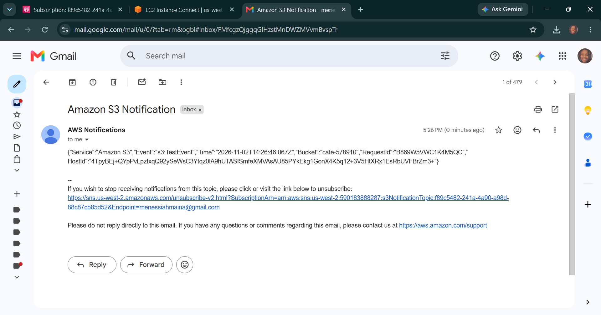
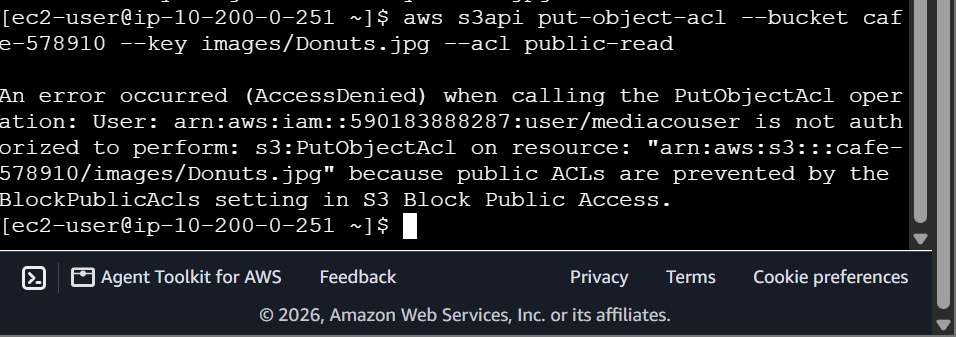

# AWS Cloud Governance: Automated S3 Event Notifications - Decoupled Pub/Sub Topologies, IAM Identity Group Security Hardening & Forensic Access Controls

## 📌 Section Overview
This module documents the practical implementation of **Event-Driven Object Storage Webhooks, IAM Identity Group Security Hardening, Access Control List (ACL) Protection Barriers, and Decoupled Messaging Pipelines** within a secure multi-user architecture. To design a resilient file-sharing workspace for third-party media vendors, we configured a globally unique Amazon S3 bucket, applied strict least-privilege prefix isolation boundaries (`/images/*`) using custom group policies, and engineered an automated notification framework that fires real-time asynchronous email alerts over an Amazon SNS messaging loop whenever storage states are modified.

---

## 🚀 Architectural Breakdown of Identity Hardening & Security Perimeters

### 1. Granular Prefix Isolation Policies
Managing multi-tenant data structures requires keeping users isolated from accessing core root assets. Instead of deploying broad permissions, we group users into logical operational cohorts (`mediaco`) and attach custom, granular **Identity-Based Policies** (`mediaCoPolicy`):
- **Bucket-Level Discovery:** Grants metadata clearance (`AllowGroupToSeeBucketListInTheConsole`) to allow users to navigate the S3 console interface cleanly without seeing raw file contents.
- **Prefix Path Enforcement:** Uses explicit resource criteria strings to restrict the external vendor's permissions (`AllowUserSpecificActionsOnlyInTheSpecificPrefix`). The user profile can execute `PutObject`, `GetObject`, and `DeleteObject` transactions *strictly if* the action targets objects inside the designated folder path (`cafe-*/images/*`), isolating the rest of the bucket namespace.

### 2. Stateful vs. Stateless Security Defenses
- **Data Manipulation Clearance:** The user profile carries the explicit parameters required to upload new product pictures or clean out stale assets within their sandbox folder.
- **Access Control List (ACL) Protection:** To protect the bucket from security policy modifications, the user policy does not grant configuration rights. If the user attempts an unauthorized transaction loop—such as trying to make a sensitive file public via an ACL overwrite (`aws s3api put-object-acl --acl public-read`)—the AWS platform instantly flags the security violation, drops the packet, and logs an explicit **`AccessDenied`** fault.

---

## ⚙️ The Event-Driven Webhook Pipeline: S3 to Amazon SNS

Traditional system auditing models require servers to run heavy background polling script loops to continuously scan folders for data updates, driving up processing latency and cost. This architecture leverages a serverless **Reactive Push Loop**:

### 1. Cross-Service Publisher Policies
Amazon S3 cannot push notification messages into a separate service plane unless it has explicit authorization to cross the service boundary. We modify the **Amazon SNS Access Policy** to append a secure permission rule block (`AllowPublishFromS3`). This statement tells the messaging core to accept incoming `SNS:Publish` commands originating strictly from the assigned S3 bucket ARN, keeping the communication channel secure.

### 2. Declarative Event Notification Mapping
Using a structured JSON manifest file (`s3EventNotification.json`), we map out the precise system conditions that will trigger a webhook alert:
- **Target Event Filter Arrays:** Focuses strictly on object data state changes: **`s3:ObjectCreated:*`** (handling uploads or copy operations) and **`s3:ObjectRemoved:*`** (handling deletions).
- **Prefix Constraints:** Binds the trigger rule to fire *only* if the modified object key carries the designated folder prefix string (`images/`).
- **The Execution Chain:** The millisecond an object hits 100% completion inside the folder, S3 catches the state transition, runs a test event handshake, and pumps an asynchronous JSON metadata block straight to **`s3NotificationTopic`**. The SNS engine parses the payload and automatically triggers an email blast (`ObjectCreated:Put`) straight to subscribed engineers' mailboxes.

---

## 🛠️ Step-by-Step Systems Operations Ingestion Lifecycle

### 1. Ingestion Partition & Content Initialization
- Authenticated the `CLI Host` instance terminal session using root lab access keys.
- Created a globally unique, region-locked storage partition bucket and used the delta sync command to batch upload the cafe's initial product image files from the local directory onto the cloud storage blocks:
  ```bash
  aws s3 mb s3://cafe-xxxx999 --region 'us-west-2' && aws s3 sync ~/initial-images/ s3://cafe-xxxx999/images
  ```

### 2. Evaluating IAM Hierarchies & Generating Keys
- Switched to the IAM console to audit the user group permissions of the `mediaco` cohort, analyzing the underlying JSON statements.
- Initialized programmatic access for `mediacouser`, generating a fresh command-line credential token pair (`.csv`).
- Opened a separate private/incognito browser tab to log in as the external vendor profile, successfully validating read, write, and delete operations inside the browser console.

### 3. Engineering the Decoupled Notification Hub
- Navigated to the Amazon Simple Notification Service panel and created a standard messaging topic named **`s3NotificationTopic`**.
- Edited the topic's internal **Access Policy JSON** config sheet to explicitly grant the S3 service (`://amazonaws.com`) permission to execute `SNS:Publish` actions.
- Mapped an email subscription endpoint to the topic and completed the out-of-band email verification handshake loop.

### 4. Binding the Notification Configuration File via CLI
- Formulated your local configuration manifest file `s3EventNotification.json` inside the terminal text editor.
- Executed an explicit `s3api` pipeline command to bind the event notification rules permanently onto the bucket:
  ```bash
  aws s3api put-bucket-notification-configuration --bucket cafe-xxxx999 --notification-configuration file://s3EventNotification.json
  ```
  Successfully intercepted the auto-generated **`s3:TestEvent`** verification payload delivered straight to your email inbox.

### 5. Running the External Vendor Triage Validation Tests
- Configured your terminal's profile variables to use the newly generated external `mediacouser` access keys.
- **Testing the Ingestion Path:** Uploaded a fresh image asset (`Caramel-Delight.jpg`) via the object API wrapper:
  ```bash
  aws s3api put-object --bucket cafe-xxxx999 --key images/Caramel-Delight.jpg --body ~/new-images/Caramel-Delight.jpg
  ```
  Verified that an automated email alert with event name **`ObjectCreated:Put`** instantly hit your inbox tracking the file name.
- **Testing the Deletion Path:** Dispatched a command to wipe an image file off the drive (`aws s3api delete-object`), confirming that an immediate email message with event name **`ObjectRemoved:Delete`** was delivered successfully.
- **Validating Perimeter Defense Result:** Attempted an unauthorized security rule override to rewrite file access controls:
  ```bash
  aws s3api put-object-acl --bucket cafe-xxxx999 --key images/Donuts.jpg --acl public-read
  ```
  The platform rejected the transaction instantly, displaying the expected **`AccessDenied`** error block on screen, proving perfect data perimeter configuration.

---

## 📸 Technical Verification Proofs

### Custom Identity Controls: Custom Least-Privilege Prefix JSON Policies Mapped over the Media Vendor Group


### Event-Driven Pipeline Active: Receiving the Automated S3 Test Event Payload via Decoupled SNS Routing


### Perimeter Security Hardened: Terminal Telemetry Log Capturing Access Denied Faults During Unauthorized Actions

