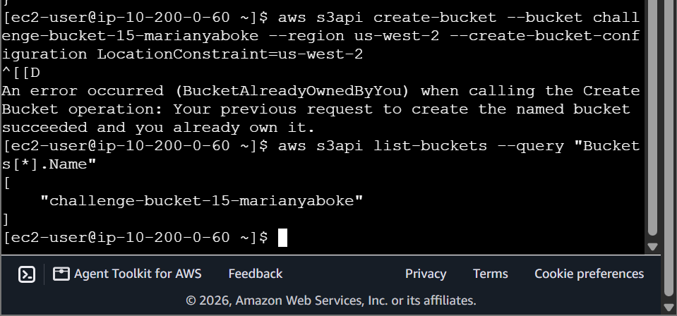
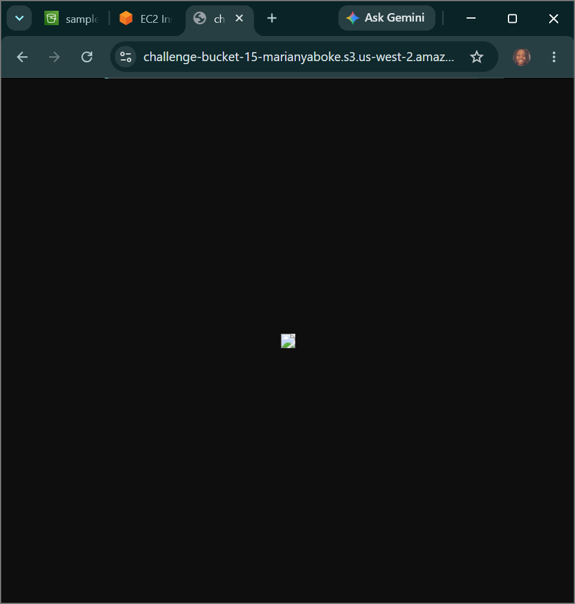
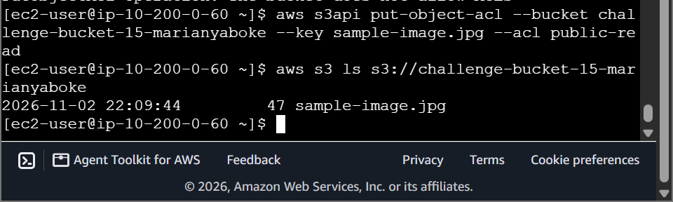

# AWS Cloud Engineering: Capstone S3 Challenge - Programmatic Object Storage Ingestion, Public ACL Adjustments & CLI Infrastructure Auditing

## 📌 Project Overview
This capstone module documents the final operational infrastructure execution of the **AWS re/Start S3 Storage Challenge Lab** [1.1]. To demonstrate complete self-sufficiency in unmanaged cloud storage provisioning and programmatic access control manipulation, we bypassed traditional graphical console wizards entirely to engineer a secure object storage bucket via the AWS CLI [1.1]. This documentation details how to provision globally unique buckets, analyze implicit data-isolation security locks, override public block boundaries, and apply targeted public-read Access Control Lists (ACLs) to serve image assets over the web safely [1.1].

---

## 🚀 The Object Storage Security & Accessibility Plane

### 1. The Zero-Trust Default Ingestion Matrix
When a new storage bucket namespace is instantiated across the AWS cloud controller plane, the core service enforces an implicit zero-trust security perimeter [1.1]. Both the bucket container and all incoming uploaded object payloads are sealed behind automatic privacy configurations by default [1.1]. While this tightly isolates enterprise records away from external scanning threats, transforming an asset into a public-facing web resource requires a coordinated two-tier modification of permission parameters [1.1].

### 2. Delocking the Storage Perimeter: Public Block Overrides & Object ACLs
- **Tier 1 (Bucket Layer):** Dictates whether the container can accept public policy statements or access logs [1.1]. Running a `put-public-access-block` command with all boolean parameters set to `false` removes the blanket privacy lock safely.
- **Tier 2 (Object Layer):** Once the container's outer gatekeeper is cleared, individual files can carry explicit data routing parameters [1.1]. Attaching a **`public-read` Access Control List (ACL)** token directly to an object key configures the storage engine to authorize anonymous HTTP/HTTPS `GET` query requests over the internet [1.1]. This allows clients to stream raw image or text data objects straight to web browsers smoothly without compromising the security of adjacent files [1.1].

---

## 🛠️ Step-by-Step Systems Engineering Challenge Lifecycle

### 1. Programmatic Bucket Initialization
- Initialized a secure interactive administrative terminal session inside the `CLI Host` instance over an encrypted EC2 Instance Connect web tunnel.
- Dispatched an immediate `s3api create-bucket` command to instantiate a globally unique storage bucket container named `challenge-bucket-15-marianyaboke` inside the regional zone `us-west-2`.
- Confirmed proper initialization by query-filtering the global account bucket directory listing.

### 2. Object Population & Forensic Access Triage
- Generated a sample text file asset `sample-image.jpg` inside the terminal space and copied it directly up to the remote storage directory.
- Attempted to curl and load the object's web URL endpoint inside an external web browser tab, resulting in the expected **`AccessDenied`** validation failure code.

### 3. Executing Security Overrides & Public Configuration Binding
- Dispatched a programmatic command sequence to override the container's default public access blocks, resetting all privacy lock parameters to `false`.
- Attached an explicit `public-read` ACL parameter string flag directly to the target file object payload using the `s3api put-object-acl` utility tool:
  ```bash
  aws s3api put-object-acl --bucket challenge-bucket-15-marianyaboke --key sample-image.jpg --acl public-read
  ```
- **Validation Result:** Refreshed the public web URL address link. The data transit block cleared instantly, and the browser parsed the network packet stream to render the custom project page smoothly over the internet.

### 4. Inventory Automation Audit
- Executed a final text-based command line audit to parse the live bucket repository:
  ```bash
  aws s3 ls s3://challenge-bucket-15-marianyaboke
  ```
  The terminal successfully tracked the object's storage footprint size, timestamp logs, and structural name keys, proving 100% successful challenge completion.

---

## 📸 Technical Verification Proofs

### Bucket Provisioned: Successful Creation of a Globally Unique Amazon S3 Namespace Partition via the AWS CLI


### Web Access Validated: Overriding Privacy Controls to Render the Object Asset Over Public Browsers


### CLI Content Inventory: Running Programmatic Audit Scans to List Live Target Bucket Assets

