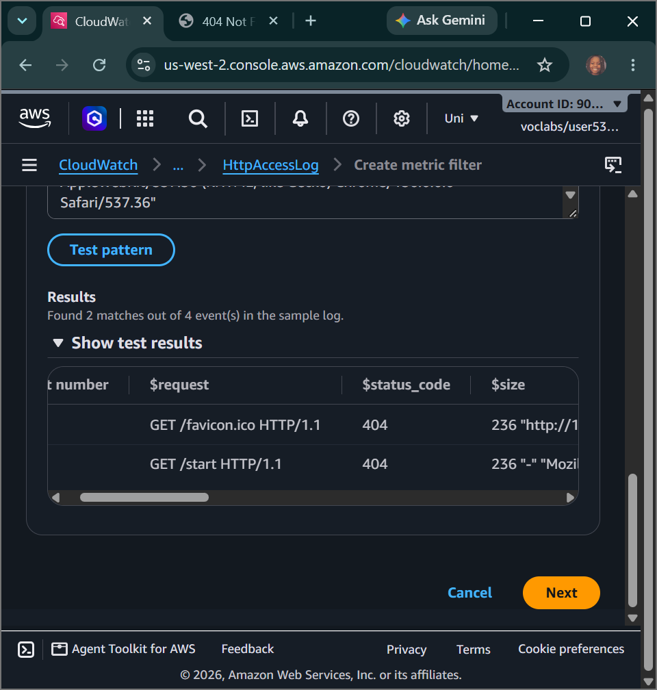
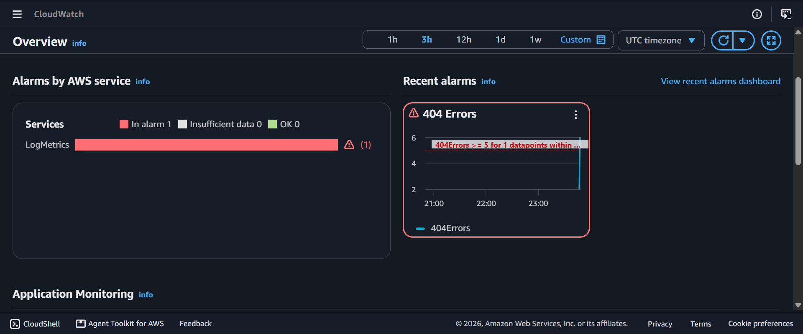

# AWS Cloud Engineering: Logs, Events & Compliance - Unified CloudWatch Log Agents, Regex Metric Filters, EventBridge Trigger Rules & AWS Config Governance Audits

## 📌 Section Overview
This module documents the practical implementation of **Centralized Server Log Aggregation, Regex Log Pattern Trimming, Near-Real-Time Event Steering, and Continuous Infrastructure Compliance Auditing**. To evaluate how distributed cloud environments maintain architectural standardizations and operational insights, we used AWS Systems Manager to install and initialize the unified CloudWatch Agent on running hosts, parsed plain-text Apache access streams (`access_log`) for application error flags, engineered event-driven response rules via **Amazon EventBridge**, and activated continuous auditing engines using **AWS Config** to isolate non-compliant orphan storage volumes.

---

## 🚀 The Log Aggregation & Metric Filter Paradigm

### 1. Centralized Log Shipping via the Unified CloudWatch Agent
Traditional server infrastructure management requires operators to log into individual instances manually via SSH to inspect raw application log files when failures strike—an anti-pattern that creates massive operational delays during cluster scale-out loops. The **Unified CloudWatch Agent** resolves this bottleneck. Operating inside the server instance kernel space, it binds to local text log targets (such as Apache `/var/log/httpd/access_log`), establishes a secure outbound TLS pipeline, and streams logs continuously up to **Amazon CloudWatch Logs**. This allows teams to decouple log inspection pools from compute nodes and audit entire horizontally scaled server fleets inside a single pane of glass.

### 2. Slicing Metrics via Filter Patterns
Once unstructured, plain-text logs are ingested, CloudWatch Logs uses **Metric Filters** to convert stream text into structured performance numbers with zero modification to application source code. By passing an explicit structural array template:
```text
[ip, id, user, timestamp, request, status_code=404, size]
```
The filter mapping engine automatically parses the token fields line-by-line. When a row match is isolated where the status code field is evaluated exactly as **`404`** (Page Not Found), the filter increments a custom metric counter parameter (`404Errors`) by **`1`** inside a dedicated namespace. Linking this custom metric to a metric alarm allows operators to catch link drift or malicious web scraping attacks automatically.

---

## ⚙️ EventBridge Real-Time Triggers & AWS Config Governance

### 1. Real-Time Event Routing (Amazon EventBridge)
**Amazon EventBridge (CloudWatch Events)** functions as a serverless, low-latency event bus that continuously intercepts architectural state changes across the AWS plane. When an EC2 instance state modifies (e.g., transitioning from `running` to `stopped`), the EC2 control controller emits a native JSON system event message block. EventBridge evaluates this block against a defined rule pattern:
```json
{
  "source": ["aws.ec2"],
  "detail-type": ["EC2 Instance State-change Notification"],
  "detail": { "state": ["stopped", "terminated"] }
}
```
The moment an exact state match is triggered, EventBridge routes the JSON payload straight to a target delivery point—such as an **Amazon SNS Topic**—blasting real-time alerts straight to administrator email boxes or messaging tunnels.

### 2. Continuous Compliance Enforcement via AWS Config
While CloudWatch monitors real-time resource performance, **AWS Config** monitors **Infrastructure Configuration Drift and Policy Compliance Governance**. AWS Config records 100% of resource configuration histories and relational changes across the account canvas. It evaluates these snapshots continuously against a comprehensive library of **AWS Managed Rules**:
- **`required-tags`:** Scans resource metadata arrays to ensure mandatory tags (e.g., auditing that every instance carries a key labeled `project`) are present for business cost allocation reporting.
- **`ec2-volume-inuse-check`:** Scans block storage environments to isolate **Orphan EBS Volumes** that are completely unattached to any running instance, flagging them as **`Noncompliant`**. This allows system administrators to purge idle block storage, cutting capital waist and optimizing cloud budgets.

---

## 🛠️ Step-by-Step Systems Engineering Implementation Lifecycle

### 1. Ingestion of the Unified CloudWatch Agent
- Navigated to the **AWS Systems Manager (SSM)** dashboard control center and choose **Run Command**.
- Invoked the pre-written automation document **`AWS-ConfigureAWSPackage`**, setting parameters to `Install` the package name `AmazonCloudWatchAgent` straight onto the target `Web Server` compute node.
- Formulated your decoupled configuration profile inside the **SSM Parameter Store** named **`Monitor-Web-Server`**, injecting the JSON metric collection manifest mapping Apache access/error log structures alongside internal RAM tracking intervals.
- Fired a secondary Run Command utilizing the document **`AmazonCloudWatch-ManageAgent`** to start the background system daemon agent process on the remote machine cleanly.

### 2. Metric Filtering & Application Alarm Injection
- Copy-pasted the public IP string `WebServerIP` into a browser tab to access the web server interface. Forced the generation of live exception log data by appending an invalid subdirectory path (`/start`) to generate a **404 Not Found error**.
- Switched to the CloudWatch Logs console and choose **Log groups**, verifying the successful arrival of the **`HttpAccessLog`** stream.
- Compiled a fresh metric filter named **`404Errors`**, passing a custom field pattern array to filter and extract row lines carrying an exact matching status code of 404.
- Engineered a CloudWatch metric alarm rule tied directly to the filter, compressing the evaluation duration window down to a fast **1-minute period**, and configuring the rule to trip if 404 frequencies evaluate as **`Greater/Equal than 5`**. Linked the action loop to provision a brand-new **Amazon SNS Topic** to manage notification routing.
- **Testing the Metric Breach:** Loaded the browser and deliberately hit five separate invalid paths in under 60 seconds. CloudWatch successfully captured the error wave, breached the condition boundary, pushed the alarm state into an active red **`In alarm`** phase, and blasted a real-time diagnostic alert email right into your mailbox.

### 3. Engineering Real-Time State Triggers via EventBridge
- Opened the EventBridge console and built a custom pattern rule labeled **`Instance_Stopped_Terminated`**.
- Targeted the EC2 service plane, setting criteria filters to listen for instance state-change notifications changing explicitly to `stopped` or `terminated`.
- Mapped the target routing path to stream the JSON event metrics straight into the account's primary SNS topic.
- **Testing the Automation Bus:** Navigated to the EC2 instances table, selected `Web Server`, and clicked **Stop instance**. The bus intercepted the change, matched the pattern rule, and pushed a real-time event alert payload directly into your email box the moment the instance entered the stopped state.

### 4. Activating Continuous Compliance Audits (AWS Config)
- Enabled the **AWS Config** engine across the regional cloud canvas to map resource configurations.
- Added the managed rule **`required-tags`**, passing parameters requiring a matching `project` key string to verify asset categorization compliance.
- Appended the managed rule **`ec2-volume-inuse-check`** to audit block storage states.
- **The Audit Result:** Config completed its environmental resource scan and successfully generated its compliance scorecard: the `Web Server` was marked fully compliant due to its existing project tag, while an unattached block device volume was correctly flagged as **`Noncompliant`**, providing an immediate operational target to delete idle blocks and optimize cloud costs.

---

## 📸 Technical Verification Proofs

### Log Centralization Active: Viewing Shipped Apache Web Access Log Data Streaming Natively in CloudWatch Logs


### Incident Mitigation Active: High-Frequency Web Exception Patterns Triggering an Active In-Alarm State


### Infrastructure Compliance Hardened: Continuous AWS Config Auditing Flagging Idle Orphan Storage Blocks

