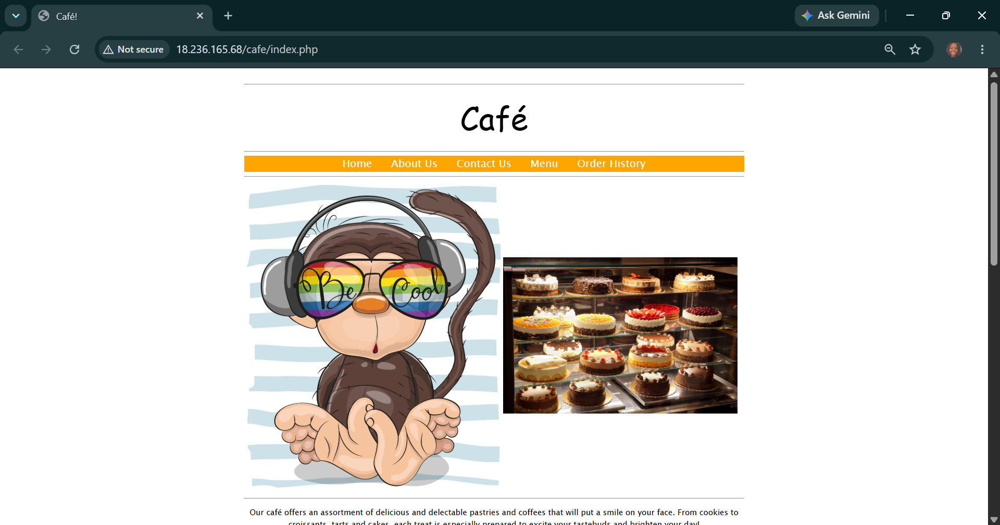
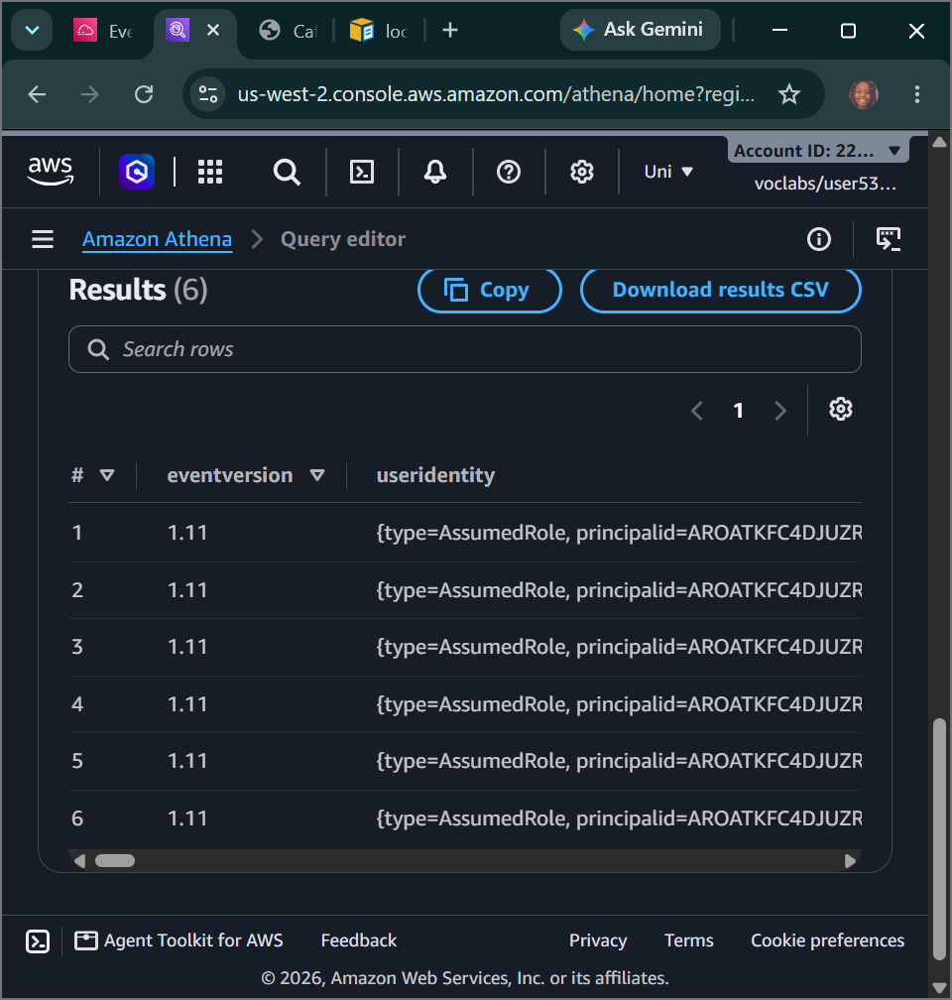
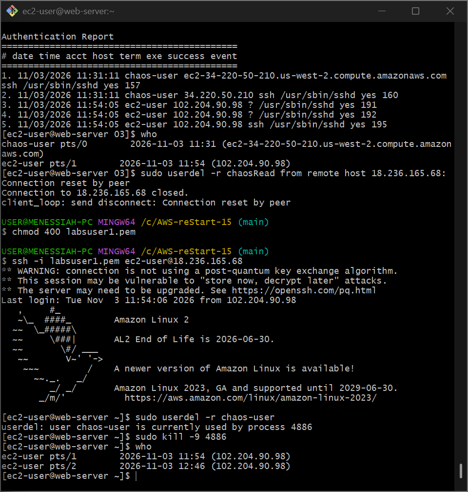

# AWS Cloud Security: Incident Response & Cloud Forensics - AWS CloudTrail Audit Lakes, Serverless Athena Threat Hunting & Host-Level Linux Malware Remediation

## 📌 Section Overview
This module documents the end-to-end implementation of **Cloud Digital Forensics, Account Activity Auditing, Serverless Log Interrogation, and Host-Level Operating System Hardening** within a live incident response lifecycle. To fulfill a critical security triage mandate following an active website compromise, we deployed an account-wide **AWS CloudTrail** audit ledger, constructed an automated log parsing schema using **Amazon Athena**, conducted advanced SQL queries to isolate unauthorized API firewall exploits, and executed terminal system commands to purge unauthorized processes, delete hostile local users, and secure broken SSH protocol configuration parameters natively.

---

## 🚀 The DFIR Architectural Blueprint: CloudTrail to Athena

When a security incident strikes an enterprise cloud architecture, finding the threat vector requires separating infrastructure indicators from system background noise. This architecture implements an automated **Security Forensics Data Stream Pipeline**:

### 1. Immutable Audit Logging (AWS CloudTrail)
- **The Core Function:** CloudTrail intercepts 100% of internal and external API calls executed across the account plane, mapping identities, event names, source IPs, and timestamps into verbose, cryptographically structured JSON record files.
- **S3 Log Ingestion Lakes:** Pushing these records continuously into a centralized, encrypted Amazon S3 bucket preserves an un-alterable historical tracking trail. If a malicious actor alters a security group rule, the change is permanently logged inside the `requestParameters` block of the ledger file, providing ironclad forensic evidence.

### 2. Serverless Log Analytics (Amazon Athena)
Manually opening and parsing hundreds of compressed JSON file archives (`.json.gz`) via basic text tools during an active threat-hunting window is highly inefficient. **Amazon Athena** completely eliminates this operational friction.
- **Schema-on-Read Queries:** By mapping a structured table definition directly over the S3 CloudTrail log directory path, Athena transforms unstructured text dumps into an interactive relational data pool. 
- **Targeted Forensic Extraction:** Security analysts execute complex ANSI SQL statements containing custom filtering strings (such as isolating `eventsource = '://amazonaws.com'`) to search millions of historical rows in seconds, pinpointing the precise identity of an adversary, their origin network location, and the software tool they used to execute the exploit.

---

## 🛠️ Step-by-Step Incident Triage & System Remediation

### 1. Incident Baseline & Trail Activation
- Audited the `Café Web Server` configuration and applied a defensive Security Group update opening TCP Port 22 (SSH) strictly to the administrator's public testing IP location block (`/32`).
- Navigated to **AWS CloudTrail** and provisioned a new continuous multi-region trail named **`monitor`**, routing its compressed log files to a dedicated, encrypted S3 bucket: `monitoring####`.
- **The Compromise:** Refreshed the web application endpoint tab to find that an attacker had bypassed security, defaced the landing page with a hostile image, and modified `WebSecurityGroup` to inject a wide-open global security vulnerability allowing SSH access from anywhere (`0.0.0.0/0`).

### 2. Serverless Threat Hunting & Hacker Isolation
- Switched to the CloudTrail Event History tab and initialized an automated database mapping, creating a custom external schema table (`cloudtrail_logs_monitoring####`).
- Opened the **Amazon Athena Query Editor**, set up a dedicated query results output folder path, and dispatched an advanced relational SQL forensic query to audit firewall manipulation events:
  ```sql
  SELECT useridentity.userName, eventname, sourceipaddress, requestparameters FROM cloudtrail_logs_monitoring#### WHERE eventsource = '://amazonaws.com' AND eventname LIKE '%SecurityGroup%';
  ```
- **The Discovery (Smoking Gun):** The query successfully isolated the malicious record: an IAM user profile named **`chaos`** programmatically executed an **`AuthorizeSecurityGroupIngress`** action, passing input parameters that forcefully injected the un-authorized global `0.0.0.0/0` SSH port opening across our cluster fabric.

### 3. Host-Level Forensic Triage & Process Termination
- Connected securely into the web server host terminal over an encrypted SSH connection.
- Audited operating system authentication records to look for host anomalies, isolating an unauthorized local user entry:
  ```bash
  sudo aureport --auth
  ```
- Executed local user tracking queries (`who`), discovering that a rogue hacker account named **`chaos-user`** held an active, running shell connection inside our system kernel.
- **Surgically Killing the Intruder:** Dispatched an immediate user erasure command, discovered the active process ID block, and fired an absolute termination signal to terminate the hacker's connection loop instantly:
  ```bash
  sudo userdel -r chaos-user  # (Identified process lock)
  sudo kill -9 <PROCESS_NUMBER>
  sudo userdel -r chaos-user  # (Successfully purged account & home directories)
  ```
- Checked the `/etc/passwd` configuration layout file to confirm that only authorized standard system daemons remained active on the OS.

### 4. Closing the Protocol Vulnerability & Deleting the IAM Threat
- **Hardening the SSH Kernel Daemon:** Opened the secure shell daemon configuration file (`/etc/ssh/sshd_config`) inside the `vi` editor. Located line 61 and completely deactivated the high-risk **`PasswordAuthentication yes`** parameter, uncommenting line 63 to enforce **`PasswordAuthentication no`**. This ensures only users carrying authorized asymmetric key pairs can ever connect, neutralizing brute-force password attacks. Restarted the daemon service:
  ```bash
  sudo service sshd restart
  ```
- **Firewall Rollback:** Returned to the EC2 panel, edited the inbound firewall rules for `WebSecurityGroup`, and deleted the `0.0.0.0/0` wildcard rule to seal the network boundary.
- **Restoring Frontend Assets:** Navigated into the web content directory (`/var/www/html/cafe/images/`) and used local file movements to swap out the hacker's defaced image with the secure, original backup asset (`Coffee-and-Pastries.backup`), instantly restoring the corporate web interface.
- **Purging the Cloud Identity:** Opened the IAM dashboard, selected the compromised **`chaos`** user profile, and executed a terminal delete transaction to permanently banish the adversary from the AWS platform entirely, completing a flawless incident response cycle.

---

## 📸 Technical Verification Proofs

### The Incident Baseline: The Defaced and Compromised Café Application Frontend Page


### The Forensic Smoking Gun: Amazon Athena SQL Query Successfully Isolating the 'chaos' Attacker API Exploit


### Host Level Remediation: Forcefully Terminating the Active Hacker Session and Deleting the Local User Account


### System Hardened & Restored: The Café Website Application Fully Remediated and Deployed Online Cleanly

