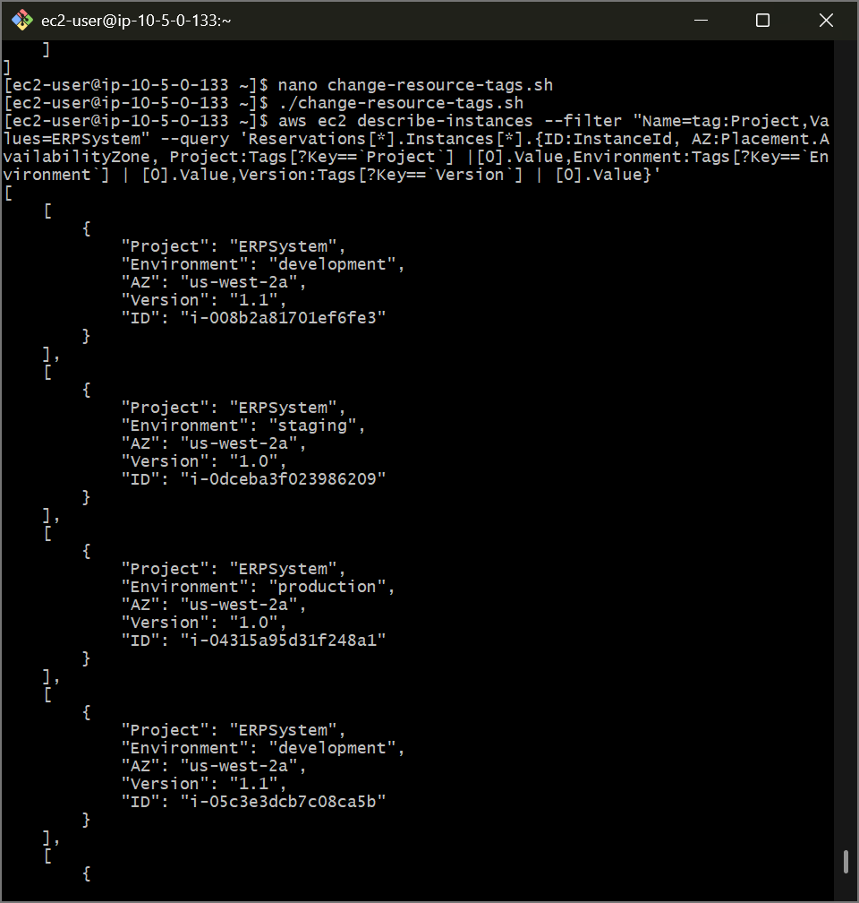
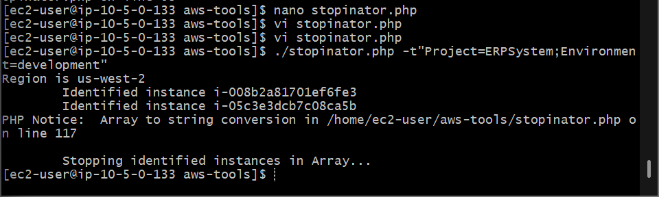
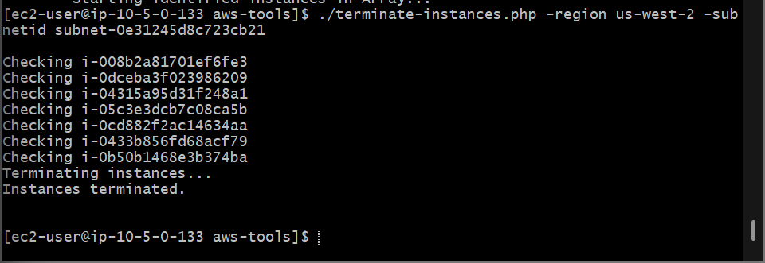

# AWS Cloud Governance: Tag-Driven Resource Automation - Advanced JMESPath Projections, Automated Dev-Environment Stopinators & Compliance Tag-or-Terminate Enforcement

## 📌 Section Overview
This module documents the practical engineering implementation of **Advanced Metadata Filtering, Client-Side Query Projections, Batch Metadata Mutation Scripts, and Automated Compliance Enforcement Pipelines** inside large-scale cloud environments. To manage resource consumption responsibly and enforce tight environment boundaries, we leveraged the AWS CLI combined with the **JMESPath** query query engine to extract specific metadata arrays from running fleets, deployed automated scripts to manage cluster power schedules, and executed an automated "Tag-or-Terminate" compliance script using the **AWS SDK** to eliminate non-compliant orphan resources programmatically.

---

## 🚀 The Architecture of Resource Metadata Governance

Managing enterprise cloud consumption across hundreds of separate development tracks requires moving past manual console grouping into robust **Metadata Tagging Frameworks**. 

### 1. Advanced Metadata Harvesting via JMESPath Queries
The AWS CLI `describe-instances` command returns massive, verbose JSON structures that can flood terminal windows and slow down automation pipelines. To optimize this data transit layer, cloud engineers leverage client-side filtering via **JMESPath Query Expressions**. Using tight extraction rules:
```text
Reservations[*].Instances[*].{ID:InstanceId, AZ:Placement.AvailabilityZone, Project:Tags[?Key==`Project`] | [0].Value}
```
The query engine automatically loops through nested reservation records, executes internal array filtering to match explicit key strings, extracts the value parameter, and aliases the field properties natively. This allows developers to flatten deep JSON payloads into clean, highly readable outputs tailored for automation engines.

### 2. Upgrading Operational Efficiency: The Stopinator Design Pattern
Operating non-production sandboxes (such as development and staging servers) continuously through nights and weekends drives up massive waste, driving up capital consumption. DevOps engineers eliminate this waste by engineering **Stopinator Automations**. Programmatic scripts hook into the AWS SDK to query specific resource metadata tags (e.g., matching `Project=ERPSystem;Environment=development`). The tool runs at the end of every business day to execute clean batch shutdowns across identified nodes, and restarts them the next morning, cutting resource costs significantly.

### 3. Strict Compliance Enforcement: The Tag-or-Terminate Principle
Enterprise security and budgeting baselines dictate that any running infrastructure component *must* carry valid tracking identifiers to allocate billing codes and map access bounds. To enforce this standard, organizations implement a automated **Tag-or-Terminate Policy**. An automated scanning tool (such as our `terminate-instances.php` script) continually audits the compute fleet:
1. **The Discovery Phase:** Queries the environment to collect all instances that carry the mandatory `Environment` tracking tag.
2. **The Verification Phase:** Compares that list against the global subnet instance pool to isolate non-compliant orphan nodes lacking the tag.
3. **The Enforcement Phase:** Dispatches an immediate API destruction command (`aws ec2 terminate-instances` or `terminateInstances()`) to purge the untagged nodes out of the cloud account permanently, eliminating security risks and untracked resource drain automatically.

---

## 🛠️ Step-by-Step Systems Engineering Implementation Lifecycle

### 1. Connect and Interrogate Fleet Metadata
- Authenticated the `Command Host` admin instance via a secure remote SSH tunnel.
- Dispatched high-level query expressions to isolate instance parameters, progressively adding advanced JMESPath array filters to map the `Project`, `Environment`, and `Version` tags of the running private compute fleet.
- Appended multi-layered conditions to filter down to the exact development servers assigned to the core ERP platform:
  ```bash
  aws ec2 describe-instances --filter "Name=tag:Project,Values=ERPSystem" "Name=tag:Environment,Values=development"
  ```

### 2. Automating Batch Metadata Overwrites
- Formulated an executable Bash script tool `change-resource-tags.sh` using the `nano` editor.
- Configured the script logic to query target development compute instances using standard text outputs (`--output text`) to flatten values into space-separated string tokens, and passed those tokens straight to the `create-tags` API engine to upgrade the software tracking version to `1.1` as a single batch operation.
- Run `./change-resource-tags.sh` and verified that non-development resource boxes remained securely un-altered.

### 3. Executing Power Optimization via the Stopinator Engine
- Advanced into the localized tooling workspace directory (`cd aws-tools`) and audited the underlying PHP SDK automation script block `stopinator.php`.
- Initiated a scheduled environment shutdown loop targeting our specific project parameters:
  ```bash
  ./stopinator.php -t"Project=ERPSystem;Environment=development"
  ```
- Monitored the Amazon EC2 Console interface to verify that the identified development compute instances safely entered a `stopping` state, cutting active runtime consumption.
- Dispatched the start parameter flag (`-s`) to reverse the pipeline loop, verifying that both nodes successfully restarted and initialized back into service smoothly.

### 4. Resolving the Tag-or-Terminate Compliance Challenge
- **Simulating Configuration Drift Faults:** Opened the EC2 Instances directory grid, selected two separate private compute server nodes, clicked Add/Edit Tags, and deleted their mandatory **`Environment`** tracking tag objects entirely to simulate an untracked resource drift.
- **Dissecting the Enforcement Code:** Opened `terminate-instances.php` inside the terminal editor to analyze how it structures its multi-stage lookup arrays and targets non-compliant compute elements via the `terminateInstances()` API method.
- **Executing Enforcement:** Pulled down your active regional zone details and target network subnet identifier codes from the details pane, and triggered the enforcement engine script:
  ```bash
  ./terminate-instances.php -region us-west-2 -subnetid subnet-0123456789abcdef0
  ```
- **The Operational Output:** The script automatically scanned the network boundaries, isolated the exact non-compliant untagged target instance IDs, bypassed the compliant nodes, and successfully executed a clean, permanent system **Terminate** operation over the non-compliant resources to restore strict enterprise infrastructure compliance.

---

## 📸 Technical Verification Proofs

### Advanced CLI Projections: JMESPath Custom Array Filtering Mapping Deep Metadata Structures into Flattened Records


### Power Scaling Automation: Stopinator SDK Execution Successfully Isolating and Powering Down Target Fleets


### Automated Compliance Enforced: Tag-or-Terminate Scripting Forcefully Purging Untagged Resources Off the Cloud Account

