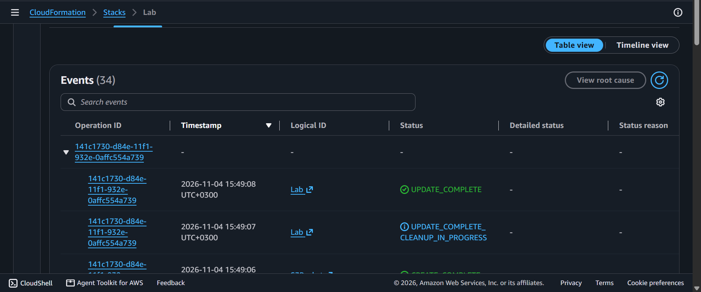
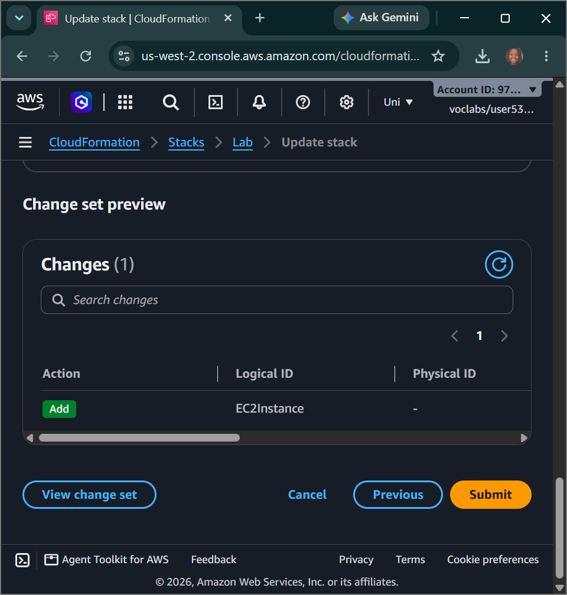
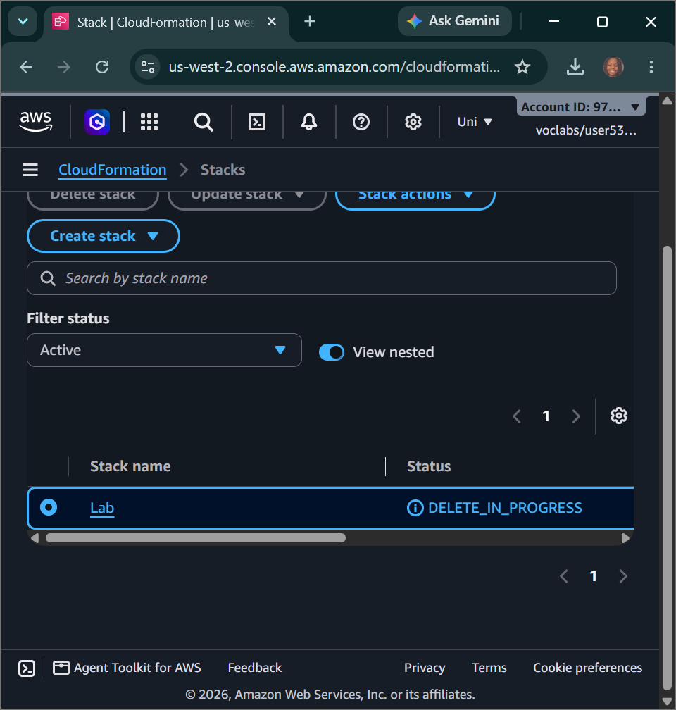

# AWS Cloud Engineering: Automation with CloudFormation - Declarative Subnet Provisioning, SSM Inbound Parameter Fetching, Change Set Previews & Automated Fleet Deletions

## 📌 Section Overview
This module documents the practical engineering implementation of **Multi-Tier Resource Provisioning, Declarative Template Mutation, Systems Manager Parameter Decoupling, Change Set Risk Analysis, and Automated Stack Lifecycle Terminations** using AWS CloudFormation [1.1, 8]. To eliminate manual infrastructure step-dependencies and prevent environmental resource configurations drift, we designed a custom YAML-based cloud template. Over multiple iterative sprint development phases, we expanded this template from a baseline networking VPC fabric into a fully comprehensive application stack containing an automated serverless data storage bucket and a parameter-driven virtual compute instance.

---

## 🚀 Architectural Foundations of the Stack Mutations

### 1. The Declarative Orchestration Advantage
Traditional infrastructure rollouts rely heavily on imperative step-by-step procedures (e.g., executing shell scripts or manual point-and-clicking) [1.1]. If a human operator builds resources out of sequence—such as attempting to map a subnet block before the parent virtual network core finishes provisioning—the pipeline crashes [1.1]. **AWS CloudFormation** eliminates this complexity by functioning as a declarative state machine [1.1, 8]. The engine parses the entire resource block, computes a deterministic dependency tree automatically, and handles resource creation pacing safely from a single file [1.1].

### 2. Eliminating AMI Drift via Systems Manager Parameters
Hardcoding an Amazon Machine Image (AMI) ID string (e.g., `ami-0abcdef1234567890`) directly into an infrastructure template is a high-risk anti-pattern [1.1]. AMIs are region-locked, frequently deprecated by vendors during security patch cycles, and vary across timelines [1.1]. This template resolves this friction by utilizing an advanced parameter type [1.1]:
```yaml
Type: AWS::SSM::Parameter::Value<AWS::EC2::Image::Id>
Default: /aws/service/ami-amazon-linux-latest/amzn2-ami-hvm-x86_64-gp2
```
This precise syntax instructs CloudFormation to run a real-time link query into the **AWS Systems Manager Parameter Store** at the exact millisecond of stack execution [1.1]. It fetches the most up-to-date, public golden image ID tracking the latest Amazon Linux 2 kernel update for that specific region [1.1]. This allows organizations to run the exact same template file across any global AWS region without manual code alterations [1.1].

### 3. Change Set Drift Safeguards
When modifying an active, running production stack (such as appending a new S3 bucket resource), instead of executing the template blindly, engineers generate a **Change Set** [1.1, 8]. The CloudFormation engine compares the modified template file against the active cloud environment canvas [1.1]. It computes the infrastructure delta and generates a **Change Set Preview (Preview Changes)**, detailing exactly which resources will be created fresh, which will remain un-altered, and whether an adjustment will trigger a destructive replacement, serving as a critical safety guardrail [1.1, 8].

---

## 🛠️ Step-by-Step Infrastructure Lifecycle Engineering

### 1. Phase 1: Deploying the Network Skeleton Base
- Formulated the baseline `task1.yaml` manifest mapping an abstract parameter block prompting for custom VPC network masks (`10.0.0.0/16`) alongside stateful firewall rules (`AppSecurityGroup`) [1.1].
- Ingested the template file into the **AWS CloudFormation Console**, naming the orchestration container **`Lab`** [1.1].
- Monitored the **Events** and **Resources** tabs, observing how CloudFormation logically paced execution states from `CREATE_IN_PROGRESS` to a verified green **`CREATE_COMPLETE`** state string [1.1].

### 2. Phase 2: Appending Serverless Storage Tiers
- Edited the local template file to extend our infrastructure scope under the `Resources:` container block header, appending an independent object storage bucket [1.1]:
  ```yaml
  S3Bucket:
    Type: "AWS::S3::Bucket"
  ```
- Uploaded the modified template file using the console's **Update Stack** wizard [1.1]. Audited the change set calculation to verify that CloudFormation correctly planned an isolated `Add` operation while keeping existing networking blocks intact [1.1, 8].
- Executed the update and verified the arrival of the bucket node under the resource tab displaying its randomly generated, collision-free physical name token [1.1].

### 3. Phase 3: Provisioning the Parameter-Driven Compute Instance
- Extended the template architecture by injecting an input parameter box (`AmazonLinuxAMIID`) linked natively to the Systems Manager Parameter Store path to handle real-time AMI lookups [1.1].
- Appended a complex compute resource block `AppServerInstance` mapping a burstable `t3.micro` instance class [1.1]. Utilized the **`!Ref` intrinsic function** to securely bind the server instance network interface directly onto `PublicSubnet` and lock its firewall ingress bounds to `AppSecurityGroup` [1.1].
- Updated the running stack, intercepted the automated change set preview validation screen, and pushed the deployment live [1.1, 8]. Verified the successful launch of the node labeled `App Server` inside the EC2 directory [1.1].

### 4. Phase 4: Automated Automated Infrastructure Teardown
- To prevent idle budget waist across the account, selected the primary `Lab` stack master container and clicked **Delete** [1.1].
- The automated engine intercepted the deletion token and automatically processed the execution tree in precise reverse sequence: termination commands were fired over the EC2 server instance first, followed by erasing the S3 bucket container, dropping firewalls, and dissolving subnets and parent VPC perimeters cleanly [1.1]. The entire multi-tier cloud landscape vanished within minutes, demonstrating full lifecycle control [1.1].

---

## 📸 Technical Verification Proofs

### Serverless Storage Expanded: Successful Update Stack Modification Deploying an Independent Amazon S3 Bucket


### Risk Management Guardrail: Change Set Previews Verifying the Precise Creation Blueprint of the EC2 Server Instance


### Automated Cloud Teardown: Deleting the Master Stack Container to Automatically Erase All Connected Cloud Resources

