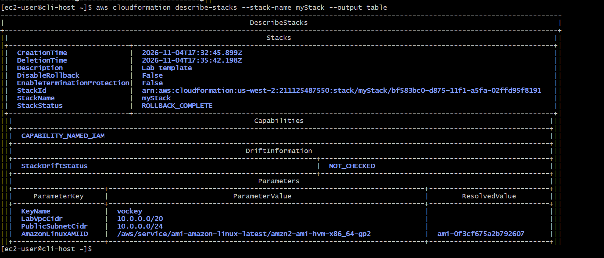
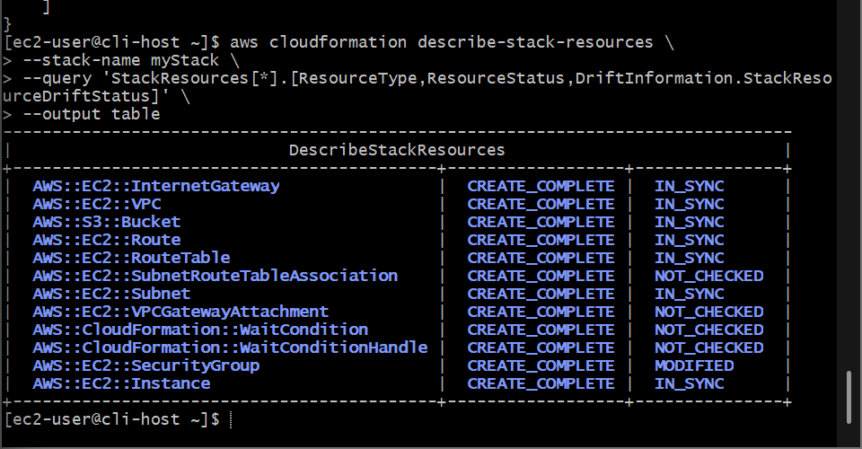
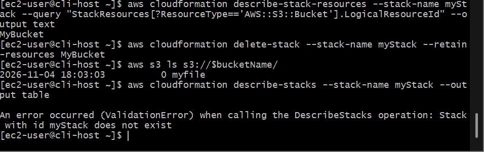

# AWS Cloud Engineering: Troubleshooting CloudFormation - Forensic Log Interrogation, Infrastructure Drift Telemetry & Resource Retain Deletion Pipelines

## 📌 Section Overview
This module documents the practical implementation of **Cloud Infrastructure Forensic Triage, Operating System Log Dissection, Resource Drift Detection, and Retain-Resource Stack Deletion Lifecycles**. To master the debugging capabilities required of modern DevOps engineering, we diagnosed a complex stack bootstrapping timeout failure, used non-rollback states (`--on-failure DO_NOTHING`) to analyze internal Linux kernel traces, tracked down security configuration drift via programmatic JMESPath filtering, and engineered a custom decoupled stack destruction pipeline to preserve populated storage assets out-of-band while safely tearing down structural resources.

---

## 🚀 Architectural Analysis of Infrastructure Triage Operations

### 1. Dissecting the WaitCondition Timeout Loop
When managing complex multi-tier stack rollouts, automated verification requires tight handshake loops. Using a **`WaitCondition`** resource tells CloudFormation to halt stack progress until an instance emits an explicit completion signal (`cfn-signal`) from its boot configurations. If any internal package installation command crashes or hits a typo exception, the shell script immediately exits with a non-zero status flag. Because the signal is never fired, the stack hits its timeout ceiling, triggers the rollback engine, and deletes the entire architecture automatically. 

Debugging these silent runtime errors requires appending the **`--on-failure DO_NOTHING`** flag. This freezes the cluster state at the exact moment of failure, blocking automated cleanup loops and granting engineers the critical time window needed to remote into the machine's kernel space to audit local log systems (`/var/log/cloud-init-output.log`).

### 2. Identifying Configuration Drift
**CloudFormation Drift Detection** enables solutions architects to verify the structural integrity of a software-defined cluster against its authoritative base template. 
- **The Mechanic:** When triggered, the engine runs a differential scan across all supported resources. If an external operator executes an out-of-band manual change in the console—such as restricting an SSH rule's source CIDR block inside a security group firewall—the drift detection scan flags the mismatch.
- **The State:** The resource transitions to a **`MODIFIED`** state flag, outputting an explicit `PropertyDifferences` JSON log mapping the precise attribute changes. This allows operations teams to identify configuration mutations and update templates cleanly to prevent production system fragility.

### 3. The Retain-Resource Destruction Pattern
To protect enterprises from catastrophic data loss, CloudFormation will forcefully reject any deletion requests (`DELETE_FAILED`) targeting an Amazon S3 bucket that holds object files. If the corporate objective requires tearing down the structural compute, firewall, and routing resources to cut costs, but the underlying data storage lake must remain live and active, engineers leverage the **`--retain-resources`** parameter. This completely de-couples the asset from the stack management layer, allowing the template metadata to achieve a clean `DELETE_COMPLETE` phase while the physical storage bucket remains active, secure, and un-altered across the cloud platform.

---

## 🛠️ Step-by-Step Forensic Infrastructure Triage Lifecycle

### 1. JMESPath Object Modeling Sandbox
- Accessed the specialized JMESPath query canvas to practice advanced array filtering constraints.
- Engineered custom boolean projection filters to isolate specific attributes nested inside complex multi-layered JSON document layouts:
  ```text
  StackResources[?ResourceType == 'AWS::EC2::Instance'].LogicalResourceId
  ```

### 2. Forensic Debugging of the Bootstrapping Lock
- Authenticated into the `CLI Host` master admin instance using secure instance connect tunnels and initialized an index stack creation command utilizing a pre-provided template code.
- **The Failure:** The initial stack creation crashed inside the `WaitCondition` phase, triggering a full environment rollback deletion.
- **Freezing the State:** Re-fired the ingestion query, appending the critical failure override command flag to freeze the infrastructure footprint in place:
  ```bash
  aws cloudformation create-stack --stack-name myStack --template-body file://template1.yaml --on-failure DO_NOTHING
  ```
- **Infiltrating the Kernel Logs:** Connected over an independent secure shell terminal jumping directly into the newly generated `Web Server` instance. Tail-inspected the deep system execution output logs to uncover the root cause of the error:
  ```bash
  tail -50 /var/log/cloud-init-output.log
  ```
  Isolated the system crash log tracking a terminal package lookup typography failure: **`No package http available`**.
- **Template Correction:** Returned to the `CLI Host` editor, entered the template's user data section on line 128, and corrected the package installer syntax to map the actual Apache web server daemon name: **`httpd`**. Purged the dead stack and successfully executed a clean build, achieving a flawless **`CREATE_COMPLETE`** state status table.

### 3. Executing Drift Telemetry Detection
- Switched to the graphical management console to simulate configuration drift, modifying the inbound SSH rule parameters of `WebServerSG` to lock access strictly to your client testing IP address.
- Returned to the admin terminal to trigger a real-time drift scan, parsing results via an optimized JMESPath query table layout:
  ```bash
  aws cloudformation detect-stack-drift --stack-name myStack
  aws cloudformation describe-stack-resources --stack-name myStack --query 'StackResources[*].[ResourceType,ResourceStatus,DriftInformation.StackResourceDriftStatus]' --output table
  ```
- **The Audit Result:** The security group resource was correctly identified with an active **`MODIFIED`** drift tag, mapping out the precise property differences.

### 4. Resolving the Capstone Deletion Challenge
- Seeded a data asset `myfile` programmatically inside the stack's storage container, and ran a standard `delete-stack` request. The engine dropped into a hard **`DELETE_FAILED`** state due to data preservation guardrails.
- **Executing the Retain-Resource Solution:** Programmatically query-extracted the bucket's exact logical ID (`MyBucket`) via text-projections, and dispatched a highly targeted termination payload passing the retain instruction:
  ```bash
  aws cloudformation delete-stack --stack-name myStack --retain-resources MyBucket
  ```
- **The Validation Outcome:** CloudFormation successfully disassembled the underlying virtual infrastructure fabric, moving the stack object cleanly into a finalized **`DELETE_COMPLETE`** state, while a secondary directory lookup verified that the data storage bucket remained fully active and populated with your project files on disk, proving expert cloud governance systems execution.

---

## 📸 Technical Verification Proofs

### Root Cause Resolved: CloudFormation Stack Successfully Initializing All Resources into a CREATE_COMPLETE State


### Architectural Drift Exposed: Detection Engine Successfully Flagging Out-Of-Band Security Group Modifications


### Capstone Retain Complete: Decoupling and Preserving Data Assets while Safely Dissolving the Stack Fabric

