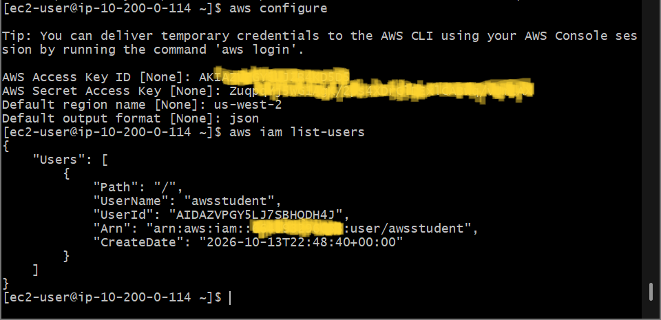
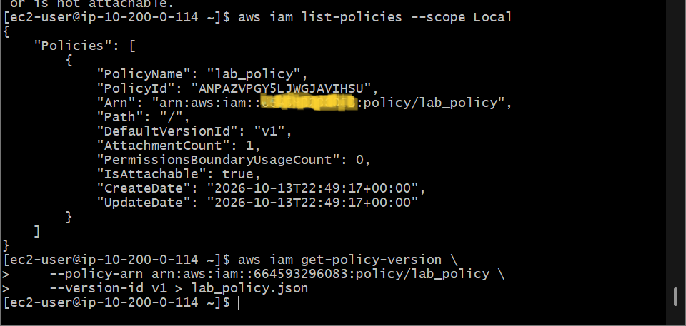

# AWS Cloud Systems Operations: Installing and Configuring AWS CLI - Red Hat Binary Deployment, Programmatic Credential Pipelining & IAM Policy Extraction Challenge

## 📌 Section Overview
This module documents the practical implementation of **System Binary Package Installation, Programmatic Identity Handshakes, and Advanced CLI Policy Extraction Operations** within a live cloud server environment. To evaluate the mechanics of managing cloud assets securely via text interfaces, we deployed version 2 of the AWS CLI tool onto a remote Red Hat Enterprise Linux host instance, configured persistent programmatic access tokens, and solved a technical challenge to extract and pipe local customer-managed security blueprints (`lab_policy.json`) using strict terminal-native commands.

---

## 🚀 Programmatic Access & Binary Ingestion Architecture

### 1. The Mechanics of CLI Binary Ingestion
Traditional Linux instances require explicit local compilation packages to communicate with external web endpoints. The AWS CLI v2 operates as an extensible command-line wrapper client engine. Ingesting this tool requires pulling zipped compression files, unpacking data contents cleanly via automated overwrite flags (`unzip -u`), and elevating administrative privileges (`sudo ./aws/install`) to bind the execution shortcuts into the operating system’s primary environment path directories.

### 2. Cryptographic API Signatures vs. Management Passwords
- **The Web Console Layer:** Human administrators log in using a unique username and a high-entropy password string. This access path triggers heavy graphical web browser page queries.
- **The Programmatic CLI Layer:** Bypasses browser windows entirely. The terminal maps requests using an immutable **Access Key ID** (acting as your public username identifier) combined with a **Secret Access Key** (acting as a cryptographic password string). The CLI utilizes these tokens to sign every individual API query signature automatically before transit, mapping the default region destination and enforcing standard output formatting constraints (`json`).

---

## 🛠️ Step-by-Step Systems Operations Ingestion Lifecycle

### 1. Environment Package Deployment
- Executed `curl` operations to download the target AWS CLI v2 installation package. Unpacked files and successfully executed the installer module script, running `aws --version` to verify proper kernel path integration.

### 2. Programmatic Handshake Configuration
- Triggered the core initialization mapping sequence (`aws configure`), injecting the lab account’s self-managed access keys, establishing the default region bounds to `us-west-2`, and setting standard result formats to structured JavaScript Object Notation (`json`).
- Verified network connectivity to the centralized identity plane by running `aws iam list-users`, capturing the resulting JSON payload output cleanly.

### 3. Resolving the Capstone Challenge via Terminal Redirection
- **Challenge Directive:** Isolate, locate, and download the exact JSON-formatted security policy document labeled `lab_policy` utilizing strictly text-based command operations.
- **Execution Script Step A (Isolating Scope):** Filtered the account’s local customer-managed policies to parse out the target resource’s Amazon Resource Name (ARN) string metadata token:
  ```bash
  aws iam list-policies --scope Local
  ```
- **Execution Script Step B (Extracting Version Metadata):** Target matched the extracted policy ARN and mapped its default version parameter indicator (`v1`).
- **Execution Script Step C (File I/O Redirection):** Executed the query tool, pairing it with the standard Linux shell redirect operator (`>`) to capture the data stream and write the plaintext contents straight to a physical backup document on the hard drive:
  ```bash
  aws iam get-policy-version --policy-arn arn:aws:iam::038946776283:policy/lab_policy --version-id v1 > lab_policy.json
  ```
- **Result Output:** The system parsed the instructions, connected securely to the IAM backend endpoint, and generated `lab_policy.json` on the disk drive volume, which was verified using the `cat` reading command.

---

## 📸 Technical Verification Proofs

### Binary Deployment: Successful Installation and Path Verification of AWS CLI v2

*(Note: As we resolve our path adjustments, ensure your fresh `lab143_cli_installation.png` is placed right inside this directory layout).*

### API Connection Validation: Successful Account Authentication Tracking User Profiles


### Capstone Challenge Extraction: Persistent JSON File Creation Tracking Customer-Managed Policies

